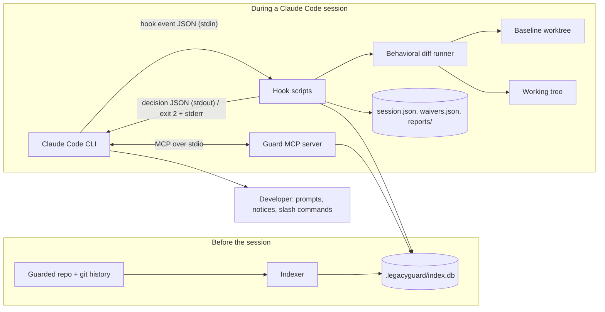
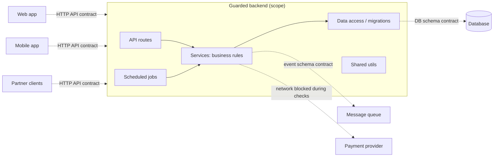
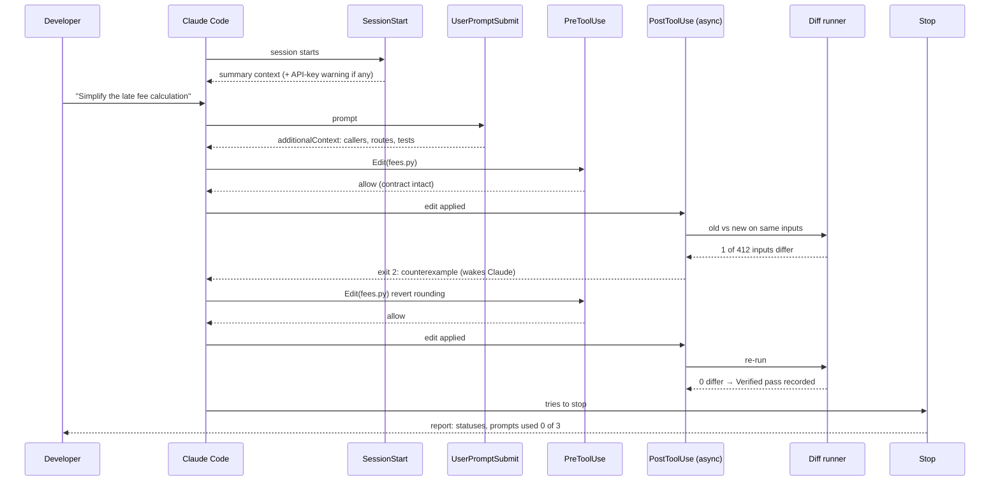
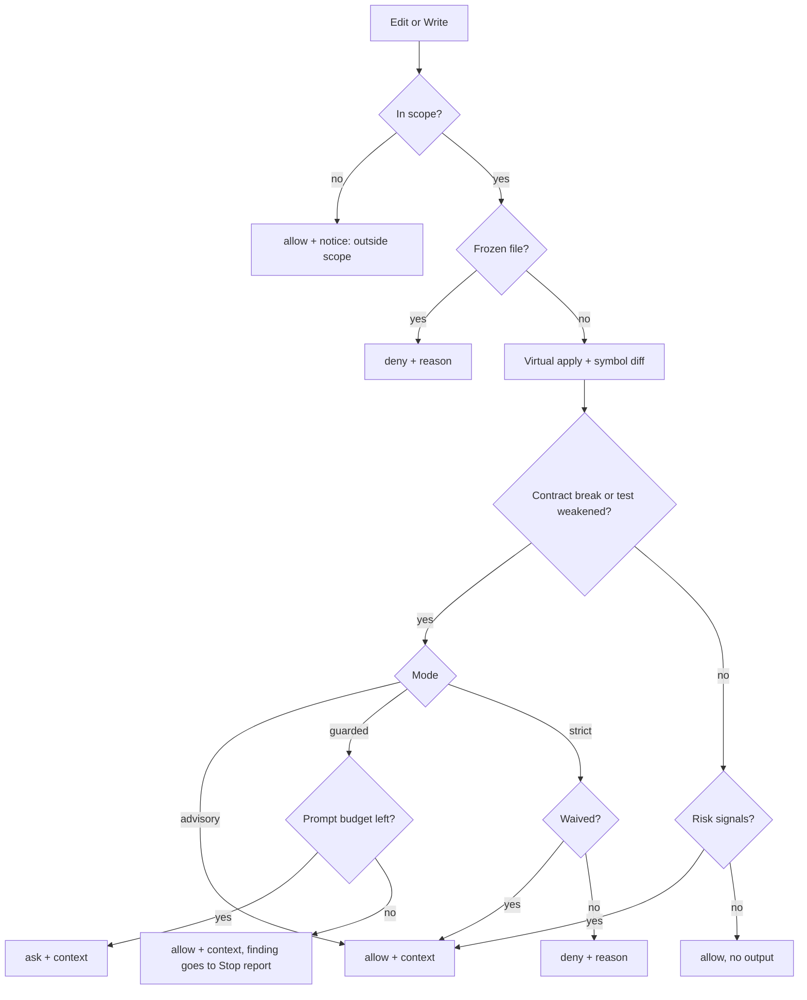
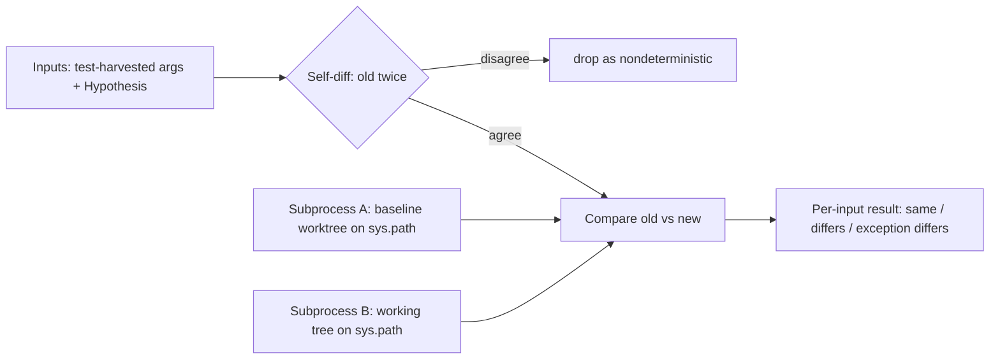

# ARCHITECTURE.md — System Design

Labels: **Confirmed**, **Proposed**, **Unresolved**. Requirement IDs refer to [REQUIREMENTS.md](REQUIREMENTS.md); decision IDs to [DECISIONS.md](DECISIONS.md).

Hook behavior described here was checked against the Claude Code hooks reference (code.claude.com/docs/en/hooks) in November 2026. Only part of that page was read in detail; Stop-hook specifics come from sections that cross-reference it (OQ-B5).

## 1. Overview (Confirmed)

There is no frontend, no server, and no cloud component. The system is:

1. **Claude Code** (the agent), running on the developer's Pro/Max plan. It is the only model.
2. **The guard**, a Claude Code plugin made of local Python processes that Claude Code starts: hook scripts and an MCP server.
3. **The guard's data**, a SQLite index plus session files under `.legacyguard/` in the guarded repo.
4. **The developer**, in the same terminal.

The guard is deterministic. It produces evidence; Claude reasons about it; the developer decides.



## 2. Scope model (Confirmed, D-010)



- **Guarded code** (scope): routes, services, data access, scheduled jobs, shared utils.
- **Contracts the guard checks but never edits:** HTTP API (openapi.yaml / route handlers), DB schema (migrations), event schemas.
- **Out of scope:** web, mobile and partner client code; third-party services.

## 3. Components and responsibilities

| Component | Responsibility | Runs | Status |
| --- | --- | --- | --- |
| Indexer | Build the four lookup tables (names, tests, routes/schema, history) into SQLite; incremental by blob SHA | `/legacyguard:index`, SessionStart | Confirmed |
| Impact library | Answer "who depends on these functions?" with sources (FR-09); shared by hooks and MCP server | Imported in-process | Confirmed |
| `session_start.py` | Bootstrap, re-index, baseline worktree, API-key warning, context summary | SessionStart hook | Confirmed |
| `prompt_context.py` | Blast-radius context for names in the prompt; store prompt text | UserPromptSubmit hook | Confirmed |
| `pre_edit.py` | Virtual apply, symbol diff, contract/test-integrity/frozen checks, decision | PreToolUse `Edit\|Write` | Confirmed |
| `post_edit.py` | Launch behavioral diff; wake Claude on difference | PostToolUse `Edit\|Write`, async + `asyncRewake` | Confirmed |
| Diff runner | Run old vs. new in two subprocesses on the same inputs; self-diff filter; network blocked | Called by `post_edit.py` and `stop_audit.py` | Confirmed |
| `stop_audit.py` | Whole-session audit; block once; write report | Stop hook | Confirmed |
| Guard MCP server | Pull queries: `impact`, `contract`, `diff_report` | stdio, started by Claude Code | Confirmed (tool list Proposed) |
| Skills | `/legacyguard:index`, `status`, `impact`, `waive`, `pin`, `mode` | Developer-invoked | Confirmed |
| Bash file-edit detector | Flag file-mutating shell commands at PreToolUse | PreToolUse `Bash` | Proposed, Future |

## 4. Communication protocols (Confirmed)

**Claude Code → hook:** JSON on stdin. Common fields: `session_id`, `transcript_path`, `cwd`, `hook_event_name`, `permission_mode`. Tool events add `tool_name`, `tool_input`, `tool_use_id`; PostToolUse adds `tool_response`. For Edit: `file_path` (absolute), `old_string`, `new_string`, `replace_all`. For Write: `file_path`, `content`. Stop adds `stop_hook_active`, `last_assistant_message`.

**Hook → Claude Code:** one JSON object on stdout, exit 0:

| Field | Reaches | Effect |
| --- | --- | --- |
| `hookSpecificOutput.additionalContext` | Claude | System reminder next to the tool result / prompt |
| `hookSpecificOutput.permissionDecision: "deny"` + `permissionDecisionReason` | Claude | Tool call blocked; Claude sees the reason |
| `hookSpecificOutput.permissionDecision: "ask"` + `permissionDecisionReason` | Developer | Permission prompt labeled `[plugin:legacyguard]`; reason not shown to Claude, so always add `additionalContext` |
| `systemMessage` | Developer | Notice in the transcript |
| `decision: "block"` + `reason` (Stop) | Claude | Claude keeps working with the reason as its next instruction |

**Async wake-up:** the PostToolUse hook runs with `asyncRewake: true`; exit 2 shows its stderr to Claude as a system reminder.

Rules: precedence across hooks is deny > defer > ask > allow; a hook's `ask` forces a prompt even in auto mode; in `claude -p` runs an unanswerable `ask` is denied and Claude reads the reason; `additionalContext` over 10,000 chars is replaced by a file path + 2,000-char preview.

**Claude Code ↔ MCP server:** stdio. Tool names are scoped `mcp__plugin_legacyguard_<server>__<tool>`.

## 5. Data storage

All under `.legacyguard/` in the guarded repo (Confirmed). Contents of each file beyond what is listed is Proposed.

| Path | Contents |
| --- | --- |
| `config.yaml` | FR-02 |
| `index.db` | SQLite lookup tables |
| `baseline/` | git worktree of the session's baseline commit |
| `session.json` | Findings ledger, prompt/wake counters, prompt text, verified functions |
| `waivers.json` | Waivers (committable) |
| `reports/` | One Markdown report per session |

Proposed `index.db` tables (schema was not discussed in detail):

```text
files(path, blob_sha, indexed_at)
symbols(id, qualname, kind, file, line_start, line_end, signature, signature_hash)
calls(caller_symbol_id, called_name, file, line)
test_cover(test_id, symbol_id)
routes(method, path, handler_qualname)
contracts(kind, path, item, detail)          -- http | db | messages
cochange(file_a, file_b, support, confidence)
```

## 6. Request lifecycle (Confirmed)



The numbers (412 inputs) are from an illustrative example, not a measurement.

### Decision policy inside PreToolUse (Confirmed, D-013, D-018)



## 7. Behavioral diff runner (Confirmed design; details Proposed)



- Both subprocesses use the target project's Python interpreter (how it is configured: OQ-B4).
- A startup file makes socket connections raise (network blocked).
- Compared: return values and exception type/message. Side effects: Unresolved (OQ-N3).
- Functions needing a DB, network or global state are reported `Untested` with the reason. Measuring how many functions are runnable is a feasibility spike (OQ-B1).
- Baseline vs. previous edit as the comparison point: Unresolved (OQ-B3).

## 8. AI / agent orchestration (Confirmed, D-015)

- Claude Code is the only agent and the only model. The guard makes **no** model calls and needs **no** API key.
- Intent judgment: the in-session Claude reads counterexamples; the developer decides. An optional prompt hook at Stop (uses the Claude Code login, counts against the plan) is Deferred and off by default.
- The model that proposes never grades its own output; execution grades.

## 9. Authentication and authorization

- **Authentication:** none in the guard. Claude Code uses the developer's Pro/Max login. If `ANTHROPIC_API_KEY` is set, Claude Code bills that key instead; SessionStart warns (Confirmed).
- **Authorization:** the guard influences actions only through Claude Code's permission system (`allow`/`ask`/`deny`). It never edits source files, never approves merges (Confirmed).
- **Trust:** text from the guarded repo (file contents, docstrings, commit messages) is data. The guard must not copy instructions from repo content into `additionalContext` as if they were rules (Proposed).

## 10. Error handling (Proposed unless marked)

- **Fail open** (D-020): a crash, timeout or invalid config never blocks Claude in the demo. `onFailure` is left unset; strict mode may set `onFailure: "block"` (Claude Code v2.1.295+).
- Hook errors are logged to `.legacyguard/guard.log` and visible via `claude --debug-file`.
- Index missing or stale → hooks fall back to name-only answers and say so in context.
- Diff runner timeout → finding `Untested` with reason "timed out".
- Stop hook blocks at most once (`stop_hook_active`) (Confirmed).
- Windows: normalize backslash paths before comparing (Confirmed).

## 11. Deployment (Confirmed, D-017)

- **Development:** `claude plugin validate ./legacyguard`, `claude --plugin-dir ./legacyguard`, `/reload-plugins` after edits.
- **Users:** GitHub repo published as a marketplace: `/plugin marketplace add <org>/legacyguard`, `/plugin install legacyguard@legacyguard`.
- **Per repo:** add `.legacyguard/config.yaml`, run `/legacyguard:index`.
- **Requirements:** Claude Code on Pro/Max (minimum version Unresolved), Python 3.10+, git.
