# LegacyGuard dev log

Generated by `tools/devlog_viz.py` from `docs/devlog.jsonl`. Do not edit by hand. For the interactive view, open `docs/devlog.html` in a browser.

## Relationship map

Solid arrows mean one entry caused another. Dashed arrows labeled "replaces" mean one entry supersedes another. Dotted lines mean the entries are related.

```mermaid
flowchart LR
  subgraph M0
    DL001["DL-001 No automatic requested labeling; every diff…"]
    DL002["DL-002 Compare against the session baseline, never…"]
    DL003["DL-003 Find the target interpreter from config, th…"]
    DL004["DL-004 Keep the name legacyguard"]
    DL005["DL-005 Pinned tests live in tests/legacyguard/ and…"]
    DL006["DL-006 Side effects stay out of the MVP"]
    DL007["DL-007 Config keys app: and django_settings: locat…"]
    DL008["DL-008 Use the official mcp Python SDK over stdio"]
    DL009["DL-009 Custom claude -p harness for A/B; try plugi…"]
    DL010["DL-010 Evaluation sizes: 10 tasks, up to 100 commi…"]
    DL011["DL-011 Frozen files are denied in every mode"]
    DL012["DL-012 Recreate the baseline worktree every session"]
    DL013["DL-013 billing-api uses FastAPI and SQLite"]
    DL014["DL-014 Give the project its own git repo and gener…"]
    DL015["DL-015 Dev log tooling, progress tracking and thei…"]
    DL016["DL-016 django-oscar's test suite runs on SQLite"]
    DL017["DL-017 Only 7.6% of oscar offer/basket functions r…"]
    DL018["DL-018 All testable hook behaviors confirmed on Cl…"]
    DL019["DL-019 Headless runs are affordable, and plugin ev…"]
  end
  subgraph M1
    DL020["DL-020 Plugin manifest and hook wiring"]
    DL021["DL-021 Use MCPServer, the mcp 2.x name for FastMCP"]
    DL022["DL-022 Shared hook runtime: fail-open, one JSON ob…"]
    DL023["DL-023 Guard allows by omitting permissionDecision…"]
  end
```



## Summary

| Milestone | feature | change | fix | decision | fallback | blocked | spike | Total |
| --- | --- | --- | --- | --- | --- | --- | --- | --- |
| M0 | 1 | 0 | 0 | 14 | 0 | 0 | 4 | 19 |
| M1 | 2 | 2 | 0 | 0 | 0 | 0 | 0 | 4 |
| **All** | **3** | **2** | **0** | **14** | **0** | **0** | **4** | **23** |

## Entries, newest first

### DL-023 · Guard allows by omitting permissionDecision, never by sending allow

**change** · M1 · T1.2 · 2026-11-05T11:31-06:00 · commit `pending`

- **Context:** FR-12 lists allow as an output value, but a hook's allow skips Claude Code's normal permission prompt, and CLAUDE.md constraint 5 says never auto-approve.
- **What:** hook_output emits no permissionDecision for allows. Only ask and deny are ever sent.
- **Why:** The hooks reference says allow skips the permission prompt. Omitting the field keeps the developer's own permission rules in charge.
- **Impact:** Deviation from REQUIREMENTS.md FR-12 Output line (permissionDecision in allow, ask, deny), following CLAUDE.md constraint 5. Fixture cases that say allow mean: not asked and not denied.
- **Files:** `legacyguard/scripts/_common.py`
- **Requirements:** `FR-12`
- **Decisions:** `D-013`, `D-018`
- **Open questions:** none
- **Tests:** `tests/test_runtime.py::test_allow_never_sets_permission_decision`
- **Evidence:**

```text
$ .venv/bin/pytest -q tests/test_runtime.py
.....................                                                    [100%]
21 passed in 0.81s
(exit 0)
```

### DL-022 · Shared hook runtime: fail-open, one JSON object, clipped context

**feature** · M1 · T1.2 · 2026-11-05T11:31-06:00 · commit `pending`

- **Context:** Hooks are short-lived processes that must never block Claude or corrupt the JSON channel.
- **What:** scripts/_common.py wraps each hook: stray prints go to stderr, any exception is logged to .legacyguard/guard.log with exit 0 and no output, and additionalContext is clipped to 1,500 characters. guardlib/config.py and paths.py read config on every call and normalize Windows paths.
- **Why:** A central wrapper means no individual hook can forget the rules.
- **Impact:** A guard bug can never freeze Claude. Mode changes apply on the next call.
- **Files:** `legacyguard/scripts/_common.py`, `legacyguard/guardlib/config.py`, `legacyguard/guardlib/paths.py`, `tests/test_runtime.py`
- **Requirements:** `FR-02`, `NFR-04`, `NFR-06`, `NFR-09`
- **Decisions:** `D-004`, `D-020`, `D-026`
- **Open questions:** `OQ-B4`
- **Tests:** `tests/test_runtime.py::test_fail_open_on_exception_exit0_no_stdout`, `tests/test_runtime.py::test_windows_paths`
- **Evidence:**

```text
$ .venv/bin/pytest -q tests/test_runtime.py
.....................                                                    [100%]
21 passed in 0.81s
(exit 0)
```

### DL-021 · Use MCPServer, the mcp 2.x name for FastMCP

**change** · M1 · T1.1 · 2026-11-05T11:30-06:00 · commit `3e3cf94`

- **Context:** D-031 names FastMCP, and mcp 2.x removed mcp.server.fastmcp.
- **What:** Import MCPServer from mcp.server.mcpserver and require mcp>=2,<3.
- **Why:** It is the same SDK class under its new name. Pinning mcp<2 would start the project on an old major version.
- **Impact:** Deviation from the wording of D-031 and OQ-N5 in docs/DECISIONS.md, not their intent.
- **Files:** `legacyguard/mcp_server/server.py`, `legacyguard/requirements.txt`
- **Requirements:** `FR-21`
- **Decisions:** `D-031`
- **Open questions:** `OQ-N5`
- **Tests:** none
- **Evidence:**

```text
$ python -c 'from mcp.server.fastmcp import FastMCP'
No module named 'mcp.server.fastmcp'. This is mcp 2.x, where FastMCP was renamed to MCPServer
```

### DL-020 · Plugin manifest and hook wiring

**feature** · M1 · T1.1 · 2026-11-05T11:30-06:00 · commit `3e3cf94`

- **Context:** The guard must install as one Claude Code plugin with five hooks and an MCP server.
- **What:** Added plugin.json, hooks.json in exec form using CLAUDE_PLUGIN_ROOT, .mcp.json, requirements.txt and stub scripts.
- **Why:** Exec form avoids shell quoting problems with paths that contain spaces, such as this project's own path.
- **Impact:** claude plugin validate passes; the plugin loads with --plugin-dir.
- **Files:** `legacyguard/.claude-plugin/plugin.json`, `legacyguard/hooks/hooks.json`, `legacyguard/.mcp.json`
- **Requirements:** `FR-01`
- **Decisions:** `D-002`, `D-017`
- **Open questions:** none
- **Tests:** none
- **Evidence:**

```text
$ claude plugin validate ./legacyguard

✔ Validation passed
(exit 0)
```

### DL-019 · Headless runs are affordable, and plugin eval works but stays optional

**spike** · M0 · T0.4 · 2026-11-05T11:25-06:00 · commit `63a2461`

- **Context:** OQ-N6 needed a usage estimate and a try of claude plugin eval.
- **What:** Timed a small Sonnet task, read /usage in -p mode, and ran plugin eval once with a regex grader.
- **Why:** M7 sizing must fit the plan. plugin eval starts in an empty directory, so the custom harness stays.
- **Impact:** A/B estimate: about $10 notional for 20 runs. Found a harness trap: Claude used python -m pytest, which the allowlist did not cover, and misreported it as a sandbox block.
- **Files:** `docs/OPEN_QUESTIONS.md`
- **Requirements:** `FR-29`
- **Decisions:** `D-032`, `D-015`
- **Open questions:** `OQ-N6`
- **Tests:** none
- **Evidence:**

```text
$ claude -p <small task> --model sonnet --output-format json
{"subtype":"success","num_turns":9,"duration_ms":25965,"total_cost_usd":0.1095}  cache_read=178028 cache_create=18598 output=1725
$ claude -p /usage
Current session: 8% used; Current week (all models): 10% used (unchanged after the runs)
$ claude plugin eval . --ablation none --trust-plugin
smoke score 1.00 (3 runs) $0.00; 1 case(s), 5s
```

### DL-018 · All testable hook behaviors confirmed on Claude Code v2.1.318

**spike** · M0 · T0.3 · 2026-11-05T11:25-06:00 · commit `fbb3000`

- **Context:** OQ-B5: the design relied on asyncRewake, ask-to-deny under -p and Stop block, from a partly read reference.
- **What:** One claude -p run with a throwaway plugin exercised every hook and token. Read the stream, the debug log and hook logs, and read the docs' async section in full.
- **Why:** One combined run stayed inside the M0 budget of 2 trial tasks.
- **Impact:** No fallback needed: the PostToolUse diff stays async with asyncRewake. Two design notes: async systemMessage reaches Claude and not the developer, and -p kills in-flight async hooks at teardown, so the Stop audit must catch what is still running.
- **Files:** `spikes/t03_hookspike/h.py`, `spikes/t03_hookspike/hooks/hooks.json`, `docs/OPEN_QUESTIONS.md`, `docs/MANUAL_CHECKS.md`
- **Requirements:** `FR-15`, `FR-18`
- **Decisions:** `D-003`, `D-004`
- **Open questions:** `OQ-B5`
- **Tests:** none
- **Evidence:**

```text
$ claude --version
2.1.318 (Claude Code)
$ claude -p "$PROMPT" --plugin-dir spikes/t03_hookspike --model haiku --permission-mode acceptEdits ... --debug-file debug.txt
debug: Hook PreToolUse returned permissionDecision: deny (reason: LGTOKEN-DENYREASON)
debug: Hook PreToolUse returned permissionDecision: ask (reason: LGTOKEN-ASKREASON)
stream: permission_denied decision_reason_type=hook decision_reason=LGTOKEN-ASKREASON
debug: Hooks: Found sync response from async_hook_86348: {"systemMessage":"LGTOKEN-ASYNCSYS",...,"additionalContext":"LGTOKEN-ASYNCCTX"}
debug: Hook PostToolUse:Write error: status code 2 stderr: LGTOKEN-REWAKE-STDERR
hooklog: stop active=False, then stop active=True
Claude listed: SESSIONCTX, PROMPTCTX, PRECTX, DENYREASON, DENYCTX, ASKREASON, ASKCTX, REWAKE-STDERR, ASYNCSYS, ASYNCCTX; then STOPREASON
```

### DL-017 · Only 7.6% of oscar offer/basket functions return a value in isolation

**spike** · M0 · T0.2 · 2026-11-05T11:25-06:00 · commit `702ea9c`

- **Context:** OQ-B1 asked what share of real functions the behavioral diff can call.
- **What:** spikes/t02_runnable.py tried all 367 defs with the DB disabled, sockets blocked and naive inputs.
- **Why:** The honest share sets expectations for the backtest before any numbers are reported.
- **Impact:** Most oscar functions will come out Untested. Catch rate will be limited, and the final report must say why.
- **Files:** `spikes/t02_runnable.py`, `docs/OPEN_QUESTIONS.md`
- **Requirements:** `FR-14`, `FR-28`
- **Decisions:** none
- **Open questions:** `OQ-B1`
- **Tests:** none
- **Evidence:**

```text
$ python spikes/t02_runnable.py   (in the oscar checkout, DB dummy backend)
{"total_defs": 367, "returned_value": 28, "ran_including_app_exceptions": 142, "share_returned": 0.076, "share_ran": 0.387,
 "by_kind": {"model-method": {"noinstance": 159, "raises": 33, "db": 4, "ok": 5}, "plain-method": {"noinstance": 35, "raises": 25, "ok": 18}, "module-level": {"raises": 18}, "view/form-method": {"noinstance": 24, "ok": 5, "raises": 38, "db": 3}}}
```

### DL-016 · django-oscar's test suite runs on SQLite

**spike** · M0 · T0.1 · 2026-11-05T11:25-06:00 · commit `b9dcf7d`

- **Context:** OQ-B1 had to establish whether the real backtest repo works without PostgreSQL.
- **What:** Cloned v4.2.2 and ran its full suite with SQLite in memory through environment variables. Confirmed its BSD-style license text.
- **Why:** The backtest needs a real repo with money logic that runs on a laptop.
- **Impact:** django-oscar stays the backtest repo; the OpenFisca fallback is not triggered. The docs' --sqlite option is gone, so the harness sets DATABASE_ENGINE and DATABASE_NAME.
- **Files:** `docs/OPEN_QUESTIONS.md`
- **Requirements:** `FR-28`
- **Decisions:** `D-014`
- **Open questions:** `OQ-B1`
- **Tests:** none
- **Evidence:**

```text
$ DATABASE_ENGINE=django.db.backends.sqlite3 DATABASE_NAME=:memory: pytest tests -q -n 4
7 failed, 1803 passed, 2 skipped, 3721 warnings, 104 subtests passed in 69.07s (0:01:09)
FAILED: 3 checkout ThankYouView, 2 catalogue category moves, 2 concurrent order placement. None in offer or basket pricing.
```

### DL-015 · Dev log tooling, progress tracking and their tests

**feature** · M0 · T0.0 · 2026-11-05T11:18-06:00 · commit `121c203`

- **Context:** The build must leave a resumable trail explaining every change.
- **What:** tools/devlog_viz.py renders DEVLOG.md and an offline devlog.html with three views; tools/devlog_check.py enforces log rules; tools/finish_task.py logs, updates PROGRESS.md, commits and backfills hashes; tools/progress.py renders PROGRESS.md.
- **Why:** Scripting the close-out keeps entries, progress and commits consistent, and stops a failing evidence command from being recorded as done.
- **Impact:** The team can open docs/devlog.html or read docs/DEVLOG.md; a new session can resume from PROGRESS.md.
- **Files:** `tools/devlog_viz.py`, `tools/devlog_check.py`, `tools/finish_task.py`, `tools/progress.py`, `tests/tools/test_devlog_tools.py`
- **Requirements:** none
- **Decisions:** none
- **Open questions:** none
- **Tests:** `tests/tools/test_devlog_tools.py::test_viz_outputs_every_id`, `tests/tools/test_devlog_tools.py::test_check_flags_commit_without_id`
- **Evidence:**

```text
$ .venv/bin/pytest -q tests/tools
....                                                                     [100%]
4 passed in 0.47s
(exit 0)
```

### DL-014 · Give the project its own git repo and generate billing-api from tracked source

**decision** · M0 · T0.0 · 2026-11-05T11:18-06:00 · commit `121c203`

- **Context:** The folder sits inside an unrelated personal repo (Life Lane), and billing-api needs its own history with paths at its repo root.
- **What:** git init in Hatchathon/. Track billing-api source at demo/billing-api-src/; demo/build_billing_repo.py generates the gitignored demo/billing-api/ with planted history.
- **Why:** Commits must not land on the personal repo's main, and a nested .git cannot be tracked by the outer repo without a submodule.
- **Impact:** After a fresh clone, run the build script to get demo/billing-api/. Deviation: CLAUDE.md's layout shows demo/billing-api/ as tracked.
- **Files:** `.gitignore`, `docs/DECISIONS.md`
- **Requirements:** `FR-27`
- **Decisions:** `D-037`, `D-014`
- **Open questions:** none
- **Tests:** none
- **Evidence:**

```text
$ git rev-parse --show-toplevel
/Users/diwashkuskusmiya/Desktop/Life Lane/Projects/Hatchathon
```

### DL-013 · billing-api uses FastAPI and SQLite

**decision** · M0 · T0.0 · 2026-11-05T11:18-06:00 · commit `121c203`

- **Context:** The stack was proposed, not confirmed.
- **What:** Confirm FastAPI + SQLite.
- **Why:** Lightweight, with route introspection and no external services.
- **Impact:** The demo runs with no database server.
- **Files:** `docs/DECISIONS.md`, `docs/OPEN_QUESTIONS.md`
- **Requirements:** `FR-27`
- **Decisions:** `D-036`
- **Open questions:** `OQ-N15`
- **Tests:** none
- **Evidence:**

```text
Recorded as D-036 in docs/DECISIONS.md and marked resolved under OQ-N15 in docs/OPEN_QUESTIONS.md; default given in the build prompt.
```

### DL-012 · Recreate the baseline worktree every session

**decision** · M0 · T0.0 · 2026-11-05T11:18-06:00 · commit `121c203`

- **Context:** Cleanup and reuse were not discussed.
- **What:** At SessionStart run git worktree remove --force, then recreate.
- **Why:** Reuse risks a stale baseline; recreation is simple and predictable.
- **Impact:** Each session starts from a fresh baseline.
- **Files:** `docs/DECISIONS.md`, `docs/OPEN_QUESTIONS.md`
- **Requirements:** `FR-10`
- **Decisions:** `D-035`
- **Open questions:** `OQ-N9`
- **Tests:** none
- **Evidence:**

```text
Recorded as D-035 in docs/DECISIONS.md and marked resolved under OQ-N9 in docs/OPEN_QUESTIONS.md; default given in the build prompt.
```

### DL-011 · Frozen files are denied in every mode

**decision** · M0 · T0.0 · 2026-11-05T11:18-06:00 · commit `121c203`

- **Context:** FR-23 lists advisory as context only for declared rules; OQ-N8 left this open.
- **What:** Deny frozen edits in advisory, guarded and strict.
- **Why:** A frozen file is an explicit developer rule, so it is the one thing that always holds.
- **Impact:** Deviation from FR-23's advisory cell, following this decision.
- **Files:** `docs/DECISIONS.md`, `docs/OPEN_QUESTIONS.md`
- **Requirements:** `FR-12`, `FR-23`
- **Decisions:** `D-034`
- **Open questions:** `OQ-N8`
- **Tests:** none
- **Evidence:**

```text
Recorded as D-034 in docs/DECISIONS.md and marked resolved under OQ-N8 in docs/OPEN_QUESTIONS.md; default given in the build prompt.
```

### DL-010 · Evaluation sizes: 10 tasks, up to 100 commits, 10 planted bugs

**decision** · M0 · T0.0 · 2026-11-05T11:18-06:00 · commit `121c203`

- **Context:** Sizes were not set.
- **What:** 10 A/B tasks; replay up to 100 commits; plant 10 bugs. Report catch rate with no target.
- **Why:** Fits plan limits while giving usable counts.
- **Impact:** The catch rate is reported as measured, with no pass mark.
- **Files:** `docs/DECISIONS.md`, `docs/OPEN_QUESTIONS.md`
- **Requirements:** `FR-28`, `FR-29`
- **Decisions:** `D-033`
- **Open questions:** `OQ-N7`
- **Tests:** none
- **Evidence:**

```text
Recorded as D-033 in docs/DECISIONS.md and marked resolved under OQ-N7 in docs/OPEN_QUESTIONS.md; default given in the build prompt.
```

### DL-009 · Custom claude -p harness for A/B; try plugin eval once

**decision** · M0 · T0.0 · 2026-11-05T11:18-06:00 · commit `121c203`

- **Context:** OQ-N6 compared the two.
- **What:** Build a harness around claude -p and try claude plugin eval once without depending on it.
- **Why:** Held-out trap checks need custom scoring and full control of the run.
- **Impact:** Evaluation does not depend on a new CLI feature.
- **Files:** `docs/DECISIONS.md`, `docs/OPEN_QUESTIONS.md`
- **Requirements:** `FR-29`
- **Decisions:** `D-032`
- **Open questions:** `OQ-N6`
- **Tests:** none
- **Evidence:**

```text
Recorded as D-032 in docs/DECISIONS.md and marked resolved under OQ-N6 in docs/OPEN_QUESTIONS.md; default given in the build prompt.
```

### DL-008 · Use the official mcp Python SDK over stdio

**decision** · M0 · T0.0 · 2026-11-05T11:18-06:00 · commit `121c203`

- **Context:** Only stdio and Python had been agreed.
- **What:** Use FastMCP from the official mcp SDK.
- **Why:** Maintained by the protocol's authors; least custom protocol code.
- **Impact:** mcp is installed in the guard's own venv at bootstrap.
- **Files:** `docs/DECISIONS.md`, `docs/OPEN_QUESTIONS.md`
- **Requirements:** `FR-03`, `FR-21`
- **Decisions:** `D-031`
- **Open questions:** `OQ-N5`
- **Tests:** none
- **Evidence:**

```text
Recorded as D-031 in docs/DECISIONS.md and marked resolved under OQ-N5 in docs/OPEN_QUESTIONS.md; default given in the build prompt.
```

### DL-007 · Config keys app: and django_settings: locate the framework

**decision** · M0 · T0.0 · 2026-11-05T11:18-06:00 · commit `121c203`

- **Context:** The indexer needs the app object to list routes.
- **What:** app: module:attribute for FastAPI; django_settings: for Django.
- **Why:** Explicit keys avoid fragile import guessing.
- **Impact:** Repos add one config line to get route data.
- **Files:** `docs/DECISIONS.md`, `docs/OPEN_QUESTIONS.md`
- **Requirements:** `FR-02`, `FR-06`
- **Decisions:** `D-030`
- **Open questions:** `OQ-N4`
- **Tests:** none
- **Evidence:**

```text
Recorded as D-030 in docs/DECISIONS.md and marked resolved under OQ-N4 in docs/OPEN_QUESTIONS.md; default given in the build prompt.
```

### DL-006 · Side effects stay out of the MVP

**decision** · M0 · T0.0 · 2026-11-05T11:18-06:00 · commit `121c203`

- **Context:** OQ-N3 asked whether to compare DB and file writes.
- **What:** Compare return values plus exception type and message; state the limit in the report footer.
- **Why:** No mechanism was designed, and an honest stated limit beats a partial check.
- **Impact:** A function that changes only a side effect is not caught by the diff.
- **Files:** `docs/DECISIONS.md`, `docs/OPEN_QUESTIONS.md`
- **Requirements:** `FR-14`, `FR-19`
- **Decisions:** `D-029`
- **Open questions:** `OQ-N3`
- **Tests:** none
- **Evidence:**

```text
Recorded as D-029 in docs/DECISIONS.md and marked resolved under OQ-N3 in docs/OPEN_QUESTIONS.md; default given in the build prompt.
```

### DL-005 · Pinned tests live in tests/legacyguard/ and only appear on /legacyguard:pin

**decision** · M0 · T0.0 · 2026-11-05T11:18-06:00 · commit `121c203`

- **Context:** FR-25 proposed tests/guard/; the location was open.
- **What:** Write tests/legacyguard/test_pinned_<id>.py only on explicit pin.
- **Why:** This is the one permitted write outside .legacyguard/, and it needs the developer's command.
- **Impact:** Deviation from FR-25's proposed path tests/guard/.
- **Files:** `docs/DECISIONS.md`, `docs/OPEN_QUESTIONS.md`
- **Requirements:** `FR-25`
- **Decisions:** `D-028`
- **Open questions:** `OQ-N2`
- **Tests:** none
- **Evidence:**

```text
Recorded as D-028 in docs/DECISIONS.md and marked resolved under OQ-N2 in docs/OPEN_QUESTIONS.md; default given in the build prompt.
```

### DL-004 · Keep the name legacyguard

**decision** · M0 · T0.0 · 2026-11-05T11:18-06:00 · commit `121c203`

- **Context:** The name was a working title.
- **What:** Keep legacyguard.
- **Why:** Renaming costs time and buys nothing for the demo.
- **Impact:** Paths and commands stay as documented.
- **Files:** `docs/DECISIONS.md`, `docs/OPEN_QUESTIONS.md`
- **Requirements:** `FR-01`
- **Decisions:** `D-027`
- **Open questions:** `OQ-N1`
- **Tests:** none
- **Evidence:**

```text
Recorded as D-027 in docs/DECISIONS.md and marked resolved under OQ-N1 in docs/OPEN_QUESTIONS.md; default given in the build prompt.
```

### DL-003 · Find the target interpreter from config, then auto-detect

**decision** · M0 · T0.0 · 2026-11-05T11:18-06:00 · commit `121c203`

- **Context:** The runner must use the target project's Python and dependencies.
- **What:** Config key python:, else .venv, venv, env, then python3/python on PATH.
- **Why:** Covers common layouts with no setup and leaves an explicit override.
- **Impact:** Most repos work with no extra config.
- **Files:** `docs/DECISIONS.md`, `docs/OPEN_QUESTIONS.md`
- **Requirements:** `FR-02`, `FR-14`
- **Decisions:** `D-026`
- **Open questions:** `OQ-B4`
- **Tests:** none
- **Evidence:**

```text
Recorded as D-026 in docs/DECISIONS.md and marked resolved under OQ-B4 in docs/OPEN_QUESTIONS.md; default given in the build prompt.
```

### DL-002 · Compare against the session baseline, never the previous edit

**decision** · M0 · T0.0 · 2026-11-05T11:18-06:00 · commit `121c203`

- **Context:** The docs left the comparison point open, and how to treat a dirty tree.
- **What:** SessionStart makes a worktree at HEAD under .legacyguard/baseline/ and copies in session-start contents of dirty or untracked in-scope files.
- **Why:** A previous-edit baseline would let a bad edit become the new normal; the session baseline keeps the original behavior as the reference.
- **Impact:** Developers' uncommitted work at session start counts as baseline, not as Claude's change.
- **Files:** `docs/DECISIONS.md`, `docs/OPEN_QUESTIONS.md`
- **Requirements:** `FR-10`, `FR-14`, `FR-18`
- **Decisions:** `D-025`
- **Open questions:** `OQ-B3`
- **Tests:** none
- **Evidence:**

```text
Recorded as D-025 in docs/DECISIONS.md and marked resolved under OQ-B3 in docs/OPEN_QUESTIONS.md; default given in the build prompt.
```

### DL-001 · No automatic requested labeling; every difference wakes Claude

**decision** · M0 · T0.0 · 2026-11-05T11:18-06:00 · commit `121c203`

- **Context:** FR-16 left the labeling mechanism open.
- **What:** Every behavior difference wakes Claude as intent unknown. The developer accepts an intended change with /legacyguard:waive.
- **Why:** A keyword or model labeler could silently excuse a real regression. A developer action cannot.
- **Impact:** Intended changes also wake Claude once, until the developer waives them.
- **Files:** `docs/DECISIONS.md`, `docs/OPEN_QUESTIONS.md`
- **Requirements:** `FR-16`, `FR-24`
- **Decisions:** `D-024`
- **Open questions:** `OQ-B2`
- **Tests:** none
- **Evidence:**

```text
Recorded as D-024 in docs/DECISIONS.md and marked resolved under OQ-B2 in docs/OPEN_QUESTIONS.md; default given in the build prompt.
```

