# LegacyGuard dev log

Generated by `tools/devlog_viz.py` from `docs/devlog.jsonl`. Do not edit by hand. For the interactive view, open `docs/devlog.html` in a browser.

## Relationship map

Solid arrows mean one entry caused another. Dashed arrows labeled "replaces" mean one entry supersedes another. Dotted lines mean the entries are related.

```mermaid
flowchart LR
  subgraph M0
    DL001["DL-001 No automatic requested labeling; every diff…"]
    DL002["DL-002 Compare against the session baseline, never…"]
    DL003["DL-003 Find the target interpreter from config, th…"]
    DL004["DL-004 Keep the name legacyguard"]
    DL005["DL-005 Pinned tests live in tests/legacyguard/ and…"]
    DL006["DL-006 Side effects stay out of the MVP"]
    DL007["DL-007 Config keys app: and django_settings: locat…"]
    DL008["DL-008 Use the official mcp Python SDK over stdio"]
    DL009["DL-009 Custom claude -p harness for A/B; try plugi…"]
    DL010["DL-010 Evaluation sizes: 10 tasks, up to 100 commi…"]
    DL011["DL-011 Frozen files are denied in every mode"]
    DL012["DL-012 Recreate the baseline worktree every session"]
    DL013["DL-013 billing-api uses FastAPI and SQLite"]
    DL014["DL-014 Give the project its own git repo and gener…"]
    DL015["DL-015 Dev log tooling, progress tracking and thei…"]
    DL016["DL-016 django-oscar's test suite runs on SQLite"]
    DL017["DL-017 Only 7.6% of oscar offer/basket functions r…"]
    DL018["DL-018 All testable hook behaviors confirmed on Cl…"]
    DL019["DL-019 Headless runs are affordable, and plugin ev…"]
  end
  subgraph M1
    DL020["DL-020 Plugin manifest and hook wiring"]
    DL021["DL-021 Use MCPServer, the mcp 2.x name for FastMCP"]
    DL022["DL-022 Shared hook runtime: fail-open, one JSON ob…"]
    DL023["DL-023 Guard allows by omitting permissionDecision…"]
    DL024["DL-024 First session start builds the guard's own …"]
    DL025["DL-025 Hooks never switched into the venv after a …"]
    DL026["DL-026 SessionStart warns about API keys and gives…"]
  end
  subgraph M2
    DL027["DL-027 billing-api: FastAPI and SQLite demo service"]
    DL028["DL-028 Five traps that the service's own tests miss"]
    DL029["DL-029 Generated billing-api repo with planted co-…"]
    DL030["DL-030 Ten A/B tasks with verified held-out checks"]
  end
  subgraph M3
    DL031["DL-031 Names table from tree-sitter, with incremen…"]
    DL032["DL-032 Test map from coverage contexts, plus a har…"]
    DL033["DL-033 Routes from the framework; HTTP, DB and eve…"]
    DL034["DL-034 Git co-change with support and confidence"]
    DL035["DL-035 Incremental index refresh"]
    DL036["DL-036 Impact library returns sources per item"]
    DL037["DL-037 MCP impact tool plus /legacyguard:index and…"]
  end
  subgraph M4
    DL038["DL-038 Session baseline worktree and findings ledg…"]
    DL039["DL-039 Compact and resume of the same session keep…"]
    DL040["DL-040 Blast-radius context for what the prompt na…"]
    DL041["DL-041 Virtual apply and symbol diff"]
    DL042["DL-042 Contract and test-integrity checks"]
    DL043["DL-043 Decision policy, modes and prompt budget"]
    DL044["DL-044 Frozen files denied in every mode; out-of-s…"]
    DL045["DL-045 Claude cannot edit the guard's own state fi…"]
  end
  subgraph M5
    DL046["DL-046 Behavioral diff runs old and new code in se…"]
    DL047["DL-047 Runner blocks network, databases, file writ…"]
    DL048["DL-048 Inputs from real tests first, then Hypothes…"]
    DL049["DL-049 Self-diff drops inputs where old code disag…"]
    DL050["DL-050 Honest Untested results with a stated reason"]
  end
```



## Summary

| Milestone | feature | change | fix | decision | fallback | blocked | spike | Total |
| --- | --- | --- | --- | --- | --- | --- | --- | --- |
| M0 | 1 | 0 | 0 | 14 | 0 | 0 | 4 | 19 |
| M1 | 4 | 2 | 1 | 0 | 0 | 0 | 0 | 7 |
| M2 | 4 | 0 | 0 | 0 | 0 | 0 | 0 | 4 |
| M3 | 7 | 0 | 0 | 0 | 0 | 0 | 0 | 7 |
| M4 | 6 | 2 | 0 | 0 | 0 | 0 | 0 | 8 |
| M5 | 5 | 0 | 0 | 0 | 0 | 0 | 0 | 5 |
| **All** | **27** | **4** | **1** | **14** | **0** | **0** | **4** | **50** |

## Entries, newest first

### DL-050 · Honest Untested results with a stated reason

**feature** · M5 · T5.5 · 2026-11-05T11:56-06:00 · commit `pending`

- **Context:** FR-14 step 6 and the hard rule: DB- or network-dependent functions are Untested, never Verified pass.
- **What:** Untested covers a connection parameter, any blocked attempt, every input raising, unbuildable signatures, constructor arguments, timeouts and new functions. Verified pass needs at least one input that returned a value.
- **Why:** A pass with nothing actually executed would be a false claim, so an all-exceptions run does not count as verified.
- **Impact:** Reports state why something was not checked.
- **Files:** `legacyguard/runner/diff.py`
- **Requirements:** `FR-14`, `FR-19`
- **Decisions:** none
- **Open questions:** none
- **Tests:** `tests/test_runner.py::test_db_function_untested_with_reason`, `tests/test_runner.py::test_every_input_raising_is_untested_not_verified`, `tests/test_runner.py::test_db_attempt_swallowed_by_target_is_still_untested`
- **Evidence:**

```text
$ .venv/bin/pytest -q tests/test_runner.py -k 'db_ or conn_ or every_input or class_needing or new_function'
......                                                                   [100%]
6 passed, 37 deselected in 2.12s
(exit 0)
```

### DL-049 · Self-diff drops inputs where old code disagrees with itself

**feature** · M5 · T5.4 · 2026-11-05T11:56-06:00 · commit `d65fb43`

- **Context:** FR-14 step 4 and D-013: time, randomness and ordering must not raise false alarms.
- **What:** Old code runs twice in separate processes; disagreeing inputs are dropped. If half or more are dropped, the function is Untested as non-deterministic. All runs use PYTHONHASHSEED=0.
- **Why:** The half rule came from a failing test: dice(0) agreed with itself, which would have turned a random function into a Verified pass on one input.
- **Impact:** No false differences on time.time(), random, set or dict order.
- **Files:** `legacyguard/runner/diff.py`
- **Requirements:** `FR-14`, `NFR-07`
- **Decisions:** `D-013`
- **Open questions:** none
- **Tests:** `tests/test_runner.py::test_nondeterministic_function_gives_no_false_difference`, `tests/test_runner.py::test_ordering_gives_no_false_difference`
- **Evidence:**

```text
$ .venv/bin/pytest -q tests/test_runner.py -k 'nondeterministic or ordering'
.....                                                                    [100%]
5 passed, 38 deselected in 1.99s
(exit 0)
```

### DL-048 · Inputs from real tests first, then Hypothesis

**feature** · M5 · T5.3 · 2026-11-05T11:56-06:00 · commit `a9c72a7`

- **Context:** FR-14 step 1: at least one harvested and one generated input for compute_late_fee.
- **What:** runner/inputs.py takes harvested calls first, then derandomized Hypothesis examples from type hints and defaults, capped at max_inputs. Decimal hints get both money-like and rate-like values. Hypothesis's cache stays under .legacyguard/.
- **Why:** Harvested inputs are realistic and find the counterexample. Generated ones cover code with weak tests. derandomize keeps a demo repeatable.
- **Impact:** The counterexample shown first comes from a real test call.
- **Files:** `legacyguard/runner/inputs.py`
- **Requirements:** `FR-14`
- **Decisions:** none
- **Open questions:** none
- **Tests:** `tests/test_runner.py::test_harvested_counterexample_shows_first`, `tests/test_runner.py::test_generated_inputs_from_hints_are_deterministic`
- **Evidence:**

```text
$ .venv/bin/pytest -q tests/test_runner.py -k 'generated or harvested or signature_we'
....                                                                     [100%]
4 passed, 39 deselected in 1.45s
(exit 0)
```

### DL-047 · Runner blocks network, databases, file writes and subprocesses

**feature** · M5 · T5.2 · 2026-11-05T11:55-06:00 · commit `b1ec996`

- **Context:** NFR-05 and CLAUDE.md constraint 9: the diff never touches real services. The guard must also write only under .legacyguard/.
- **What:** lg_worker.install_blocks patches socket, sqlite3, open and subprocess before target code loads. Blocks raise a BaseException, and each attempt is recorded even if the target swallows it. The worker gets no environment variables whose names look like secrets, and uses -B so no __pycache__ appears.
- **Why:** Running a project's code is only acceptable if it cannot reach anything real.
- **Impact:** A function that opens a socket or database is reported Untested with that reason, never Verified pass. Limit: this blocks Python-level calls; a C extension opening its own socket is not intercepted.
- **Files:** `legacyguard/runner/lg_worker.py`
- **Requirements:** `FR-14`, `NFR-02`, `NFR-05`, `NFR-11`
- **Decisions:** `D-012`
- **Open questions:** none
- **Tests:** `tests/test_runner.py::test_network_is_blocked_in_the_runner`, `tests/test_runner.py::test_worker_blocks_network_directly`, `tests/test_runner.py::test_secrets_are_not_passed_to_target_code`
- **Evidence:**

```text
$ .venv/bin/pytest -q tests/test_runner.py -k 'network or secrets or file_writes or no_pycache'
......                                                                   [100%]
6 passed, 37 deselected in 2.07s
(exit 0)
```

### DL-046 · Behavioral diff runs old and new code in separate processes

**feature** · M5 · T5.1 · 2026-11-05T11:55-06:00 · commit `a567e30`

- **Context:** FR-14 and D-012: the decisive evidence is running both versions on the same inputs.
- **What:** runner/diff.py starts lg_worker.py under the target's Python against the baseline worktree and the working tree, passes both the same inputs by file, and compares canonical results plus exception type and message. lg_codec.py gives deterministic encoding, ordering sets and dicts and scrubbing memory addresses.
- **Why:** Separate processes keep old and new modules from sharing an import cache. The worker refuses a module that resolved outside its tree, so an installed copy can never pose as the old or new code.
- **Impact:** Arguments are passed positionally in baseline order, so renaming a parameter alone is not a difference while reordering one is. A changed module constant also tests the functions in that file that read it. Side effects are not compared (D-029).
- **Files:** `legacyguard/runner/diff.py`, `legacyguard/runner/lg_worker.py`, `legacyguard/runner/lg_codec.py`, `tests/test_runner.py`
- **Requirements:** `FR-14`
- **Decisions:** `D-012`, `D-025`, `D-026`, `D-029`
- **Open questions:** `OQ-B3`, `OQ-B4`, `OQ-N3`
- **Tests:** `tests/test_runner.py::test_unchanged_code_identical`, `tests/test_runner.py::test_known_change_differs`, `tests/test_runner.py::test_exception_difference`
- **Evidence:**

```text
$ .venv/bin/pytest -q tests/test_runner.py -k 'unchanged or known_change or exception or timeout or changed_constant or renamed_parameter or syntax_error or methods or module_for or codec or canon'
......................                                                   [100%]
22 passed, 21 deselected in 5.79s
(exit 0)
```

### DL-045 · Claude cannot edit the guard's own state files

**change** · M4 · T4.6 · 2026-11-05T11:51-06:00 · commit `f51bd50`

- **Context:** The model must not grade its own output. An Edit to waivers.json or config.yaml would let Claude waive its own findings or switch to advisory.
- **What:** PreToolUse denies Edit and Write under .legacyguard/ in every mode. waive, pin, mode and index skills set disable-model-invocation.
- **Why:** CLAUDE.md constraint 8. This is an extension beyond the written FR list, so it is logged here.
- **Impact:** Known gap: a Bash command could still write these files, because Bash is not hooked in the MVP (FR-13 is Future). Listed in the final report's limitations.
- **Files:** `legacyguard/scripts/pre_edit.py`
- **Requirements:** `FR-12`, `FR-24`
- **Decisions:** `D-018`
- **Open questions:** none
- **Tests:** `tests/test_pre_edit.py::test_guard_state_is_protected_in_every_mode`
- **Evidence:**

```text
$ .venv/bin/pytest -q tests/test_pre_edit.py -k 'frozen or outside or guard_state or old_string or unparsable or invalid_config'
........                                                                 [100%]
8 passed, 39 deselected in 5.44s
(exit 0)
```

### DL-044 · Frozen files denied in every mode; out-of-scope edits get a notice

**feature** · M4 · T4.6 · 2026-11-05T11:51-06:00 · commit `f51bd50`

- **Context:** D-034 denies frozen files even in advisory. D-010 says out-of-scope edits get a warning and no check.
- **What:** pre_edit.py denies frozen files, notifies once per out-of-scope file, and fails open on invalid config.
- **Why:** A frozen file is an explicit developer rule.
- **Impact:** Deviation from FR-23's advisory cell, following D-034.
- **Files:** `legacyguard/scripts/pre_edit.py`
- **Requirements:** `FR-12`, `FR-23`
- **Decisions:** `D-034`, `D-010`
- **Open questions:** `OQ-N8`
- **Tests:** `tests/test_pre_edit.py::test_frozen_denied_in_every_mode`
- **Evidence:**

```text
$ .venv/bin/pytest -q tests/test_pre_edit.py -k 'frozen or outside or guard_state or old_string or unparsable or invalid_config'
........                                                                 [100%]
8 passed, 39 deselected in 5.44s
(exit 0)
```

### DL-043 · Decision policy, modes and prompt budget

**feature** · M4 · T4.5 · 2026-11-05T11:51-06:00 · commit `cb7934b`

- **Context:** D-013, D-018 and the TESTING.md fixture table define who gets interrupted and when.
- **What:** policy.py decides allow, ask or deny from mode, prompts used and waiver. pre_edit.py applies it, records findings once, and sends context with every ask. Risk signals are context only, and sent once per symbol. A waiver holds only for the same code hash.
- **Why:** A pure policy function can be tested directly against the fixture table. A guardrail that blocks good roads gets switched off, so only evidence can interrupt.
- **Impact:** The fourth contract break in a session does not prompt and goes to the report.
- **Files:** `legacyguard/guardlib/policy.py`, `legacyguard/scripts/pre_edit.py`, `tests/test_pre_edit.py`
- **Requirements:** `FR-12`, `FR-20`, `FR-23`, `NFR-07`
- **Decisions:** `D-013`, `D-018`
- **Open questions:** none
- **Tests:** `tests/test_pre_edit.py::test_policy_table`, `tests/test_pre_edit.py::test_fourth_break_in_a_session_does_not_prompt`, `tests/test_pre_edit.py::test_waiver_stops_applying_when_code_changes`
- **Evidence:**

```text
$ .venv/bin/pytest -q tests/test_pre_edit.py -k 'policy or fixture or fourth or waiver or mode_change or fast'
................                                                         [100%]
16 passed, 31 deselected in 6.91s
(exit 0)
```

### DL-042 · Contract and test-integrity checks

**feature** · M4 · T4.4 · 2026-11-05T11:51-06:00 · commit `19961bb`

- **Context:** FR-12 step 4 and FR-17: dropped fields, dropped columns, retyped events and weakened tests must reach a person.
- **What:** checks.py compares before and after for openapi.yaml, migrations (real SQL in memory, plus statement patterns), event schemas, route decorators, handler parameters, response models and serializer dict keys, and test files (deleted, assertion removed, weakened, skipped).
- **Why:** Checking Python as well as the contract file catches a field dropped from code while openapi.yaml still promises it. Changing an expected value alone is not flagged as weakening, because it can be legitimate.
- **Impact:** Each break names the exact item and contract file.
- **Files:** `legacyguard/guardlib/checks.py`
- **Requirements:** `FR-12`, `FR-17`
- **Decisions:** `D-010`, `D-013`
- **Open questions:** none
- **Tests:** `tests/test_pre_edit.py::test_dropped_response_field_asks`, `tests/test_pre_edit.py::test_test_integrity_unit`, `tests/test_pre_edit.py::test_event_field_removed_or_retyped_asks`
- **Evidence:**

```text
$ .venv/bin/pytest -q tests/test_pre_edit.py -k 'dropped or openapi or route_removed or migration or event or integrity or removed_assertion or new_test'
...........                                                              [100%]
11 passed, 36 deselected in 6.12s
(exit 0)
```

### DL-041 · Virtual apply and symbol diff

**feature** · M4 · T4.3 · 2026-11-05T11:51-06:00 · commit `5658c0e`

- **Context:** FR-12 step 3: judge an edit before it happens.
- **What:** virtual.py applies an Edit or Write in memory and returns None when the tool would fail by itself. symbol_diff.py classifies added, deleted, renamed, visibility_changed, signature_changed and body_changed.
- **Why:** Identical bodies are ambiguous, so a rename is only claimed when exactly one pair matches. That avoids a false story about the edit.
- **Impact:** A missing old_string gives no finding, and Claude's tool reports it instead.
- **Files:** `legacyguard/guardlib/virtual.py`, `legacyguard/guardlib/symbol_diff.py`
- **Requirements:** `FR-12`
- **Decisions:** none
- **Open questions:** none
- **Tests:** `tests/test_pre_edit.py::test_virtual_apply_cases`, `tests/test_pre_edit.py::test_symbol_diff_kinds`
- **Evidence:**

```text
$ .venv/bin/pytest -q tests/test_pre_edit.py -k 'virtual or symbol_diff or identical'
...                                                                      [100%]
3 passed, 44 deselected in 0.29s
(exit 0)
```

### DL-040 · Blast-radius context for what the prompt names

**feature** · M4 · T4.2 · 2026-11-05T11:51-06:00 · commit `7ca69c9`

- **Context:** FR-11: Claude should know the dependents before planning, and the prompt must never be changed.
- **What:** prompt_context.py finds indexed files and functions named in the prompt, adds their impact, and stores the prompt text. Two consecutive words of a function name also match, so 'late fee' finds compute_late_fee.
- **Why:** Developers write in plain words. The match is only context and cannot interrupt anyone, so over-matching costs little.
- **Impact:** Runs in well under 2 seconds on billing-api.
- **Files:** `legacyguard/scripts/prompt_context.py`
- **Requirements:** `FR-11`, `NFR-03`
- **Decisions:** none
- **Open questions:** none
- **Tests:** `tests/test_pre_edit.py::test_prompt_words_find_function`, `tests/test_pre_edit.py::test_prompt_naming_file_gets_callers_routes_tests`
- **Evidence:**

```text
$ .venv/bin/pytest -q tests/test_pre_edit.py -k 'prompt_naming or prompt_words or prompt_stored'
...                                                                      [100%]
3 passed, 44 deselected in 4.62s
(exit 0)
```

### DL-039 · Compact and resume of the same session keep the baseline

**change** · M4 · T4.1 · 2026-11-05T11:51-06:00 · commit `e6c6ef6`

- **Context:** D-035 says remove and recreate at each SessionStart, but SessionStart also fires on compaction and resume within one session.
- **What:** Recreate only for a new session or a startup or clear source. A resume or compact with the same session ID and an existing baseline keeps both baseline and ledger.
- **Why:** Recreating mid-session would make Claude's own edits the new baseline, silently hiding its regressions, and would reset the prompt budget.
- **Impact:** Deviation from the literal wording of D-035 in docs/DECISIONS.md, and it serves that decision's purpose.
- **Files:** `legacyguard/scripts/session_start.py`
- **Requirements:** `FR-10`
- **Decisions:** `D-035`, `D-025`
- **Open questions:** `OQ-N9`
- **Tests:** `tests/test_pre_edit.py::test_compact_keeps_baseline_and_ledger`
- **Evidence:**

```text
$ .venv/bin/pytest -q tests/test_pre_edit.py -k 'baseline or compact or git_repo'
.....                                                                    [100%]
5 passed, 42 deselected in 1.38s
(exit 0)
```

### DL-038 · Session baseline worktree and findings ledger

**feature** · M4 · T4.1 · 2026-11-05T11:51-06:00 · commit `e6c6ef6`

- **Context:** D-025 and D-035: compare against the state at session start, including dirty files, and recreate it each session.
- **What:** guardlib/baseline.py makes a detached worktree at HEAD and copies in dirty or untracked in-scope files. guardlib/ledger.py keeps session.json under a file lock, because hooks are separate processes. .legacyguard/.gitignore keeps runtime files out of git while config.yaml and waivers.json stay committable.
- **Why:** A worktree gives importable old code. A lock keeps concurrent async checks from losing findings.
- **Impact:** Uncommitted work present at start counts as baseline, not as Claude's change.
- **Files:** `legacyguard/guardlib/baseline.py`, `legacyguard/guardlib/ledger.py`, `legacyguard/guardlib/waivers.py`, `legacyguard/scripts/session_start.py`
- **Requirements:** `FR-10`, `FR-20`
- **Decisions:** `D-025`, `D-035`, `D-021`
- **Open questions:** `OQ-B3`, `OQ-N9`
- **Tests:** `tests/test_pre_edit.py::test_baseline_includes_dirty_and_untracked_files`, `tests/test_pre_edit.py::test_baseline_recreated_each_session_and_ledger_reset`
- **Evidence:**

```text
$ .venv/bin/pytest -q tests/test_pre_edit.py -k 'baseline or compact or git_repo'
.....                                                                    [100%]
5 passed, 42 deselected in 1.38s
(exit 0)
```

### DL-037 · MCP impact tool plus /legacyguard:index and /legacyguard:impact

**feature** · M3 · T3.7 · 2026-11-05T11:46-06:00 · commit `58736b8`

- **Context:** FR-21 and FR-22: Claude and the developer both need to query the index.
- **What:** MCPServer over stdio exposes impact. Skills call scripts/lg.py with shell injection. scripts/mcp_launch.py starts the server under the guard's venv.
- **Why:** The pull channel complements push hooks (D-002). index and later waive, pin and mode set disable-model-invocation, because those are developer actions.
- **Impact:** In a live claude -p run the guard server was connected and Claude called impact. Skills need an allowed-tools line, or their shell injection is refused in headless runs.
- **Files:** `legacyguard/mcp_server/server.py`, `legacyguard/scripts/lg.py`, `legacyguard/scripts/mcp_launch.py`, `legacyguard/skills/index/SKILL.md`, `legacyguard/skills/impact/SKILL.md`, `tests/test_mcp_server.py`
- **Requirements:** `FR-21`, `FR-22`
- **Decisions:** `D-002`, `D-031`
- **Open questions:** `OQ-N5`
- **Tests:** `tests/test_mcp_server.py::test_impact_over_stdio`
- **Evidence:**

```text
$ .venv/bin/pytest -q tests/test_mcp_server.py; claude plugin validate ./legacyguard | tail -1; cat /private/tmp/claude-501/-Users-diwashkuskusmiya-Desktop-Life-Lane-Projects-Hatchathon/560ac7f3-e1fe-4a27-8afd-837aa682bbbd/scratchpad/skill.txt
.                                                                        [100%]
1 passed in 1.03s
✔ Validation passed
```
compute_late_fee (billing/fees.py)
callers  fee_for_balance() [names,tests]  accrue_late_fee() [names,tests]  projected_fee() [names,history 71%] no test reaches it  aging_bucket() [names] no test reaches it  settle_invoice() [names,tests]  close_month() 
routes   GET /reports/aging/{invoice_id} [routes]  POST /invoices/{invoice_id}/settle [routes]
tests    9 [tests]
co-change db/rates.sql [history 82%]  jobs/close_month.py [history 71%]
```
(exit 0)
Live claude -p (haiku), init event: MCP plugin:legacyguard:guard status=connected; tools=[mcp__plugin_legacyguard_guard__impact]; skills=[legacyguard:impact, legacyguard:index]. Claude called the tool and printed FR-09 output. SessionStart hook: exit 0, summary delivered.
```

### DL-036 · Impact library returns sources per item

**feature** · M3 · T3.6 · 2026-11-05T11:45-06:00 · commit `9e3b897`

- **Context:** FR-09: answer who depends on a function, with each item labeled so a static guess never poses as proof.
- **What:** guardlib/impact.py walks callers up to 3 hops by name, adds routes, tests and co-changed files, and renders text capped at 1,500 characters with a truncation count.
- **Why:** One shared library keeps hooks and the MCP server consistent, and name matching was chosen over a call graph in D-005.
- **Impact:** Output for compute_late_fee reproduces the FR-09 example with billing-api's real data.
- **Files:** `legacyguard/guardlib/impact.py`, `tests/test_impact.py`
- **Requirements:** `FR-09`, `NFR-04`
- **Decisions:** `D-005`, `D-006`
- **Open questions:** none
- **Tests:** `tests/test_impact.py::test_fr09_output_for_compute_late_fee`, `tests/test_impact.py::test_every_item_carries_sources`
- **Evidence:**

```text
$ .venv/bin/pytest -q tests/test_impact.py; cd demo/billing-api && CLAUDE_PROJECT_DIR=$PWD ../../.venv/bin/python ../../legacyguard/scripts/lg.py impact compute_late_fee
........                                                                 [100%]
8 passed in 3.10s
compute_late_fee (billing/fees.py)
callers  fee_for_balance() [names,tests]  accrue_late_fee() [names,tests]  projected_fee() [names,history 71%] no test reaches it  aging_bucket() [names] no test reaches it  settle_invoice() [names,tests]  close_month() [names,history 71%] no test reaches it  invoice_aging() [names] no test reaches it  aging_report() [names] no test reaches it  +1 more
routes   GET /reports/aging/{invoice_id} [routes]  POST /invoices/{invoice_id}/settle [routes]
tests    9 [tests]
co-change db/rates.sql [history 82%]  jobs/close_month.py [history 71%]
(exit 0)
```

### DL-035 · Incremental index refresh

**feature** · M3 · T3.5 · 2026-11-05T11:45-06:00 · commit `d684f19`

- **Context:** FR-08: re-index quickly on every session start.
- **What:** indexer/__main__.py refreshes names by blob SHA, rebuilds contracts, rebuilds routes only when code changed, rebuilds history only when HEAD moved, and runs tests only on request.
- **Why:** Each table has a different cost, so each has its own trigger.
- **Impact:** Re-indexing after a one-file change parses one file.
- **Files:** `legacyguard/indexer/__main__.py`
- **Requirements:** `FR-08`
- **Decisions:** none
- **Open questions:** none
- **Tests:** `tests/test_names.py::test_incremental_touches_one_file`
- **Evidence:**

```text
$ .venv/bin/pytest -q tests/test_names.py::test_incremental_touches_one_file
.                                                                        [100%]
1 passed in 0.41s
(exit 0)
```

### DL-034 · Git co-change with support and confidence

**feature** · M3 · T3.4 · 2026-11-05T11:45-06:00 · commit `46abd2a`

- **Context:** FR-07: tell Claude which files usually change together.
- **What:** history.py mines git log, ignores commits touching more than 30 files, and keeps pairs with at least 3 shared commits.
- **Why:** Bulk commits say nothing about coupling and would otherwise swamp the table.
- **Impact:** The planted pair is reported as db/rates.sql 82% and jobs/close_month.py 71%.
- **Files:** `legacyguard/indexer/history.py`
- **Requirements:** `FR-07`
- **Decisions:** `D-005`
- **Open questions:** none
- **Tests:** `tests/test_index_parts.py::test_billing_planted_pair_reported`
- **Evidence:**

```text
$ .venv/bin/pytest -q tests/test_index_parts.py -k 'cochange or planted'
..                                                                       [100%]
2 passed, 18 deselected in 3.00s
(exit 0)
```

### DL-033 · Routes from the framework; HTTP, DB and event contracts as comparable items

**feature** · M3 · T3.3 · 2026-11-05T11:44-06:00 · commit `337ad6a`

- **Context:** FR-06: map routes to handlers using the framework itself, and read contracts named in config.
- **What:** routes.py imports the app in the target interpreter with blocks in place and walks its routes, falling back to decorators. contracts_parse.py turns openapi.yaml, SQL migrations and JSON Schemas into item maps. SQL runs in a private in-memory database to get the real resulting columns.
- **Why:** Comparable item maps make every contract check the same operation, before versus after. Running the SQL is more accurate than regex alone; regex remains for statements and Django migrations.
- **Impact:** Every billing-api route maps to its handler. FastAPI 0.16x nests included routers, which the walker handles.
- **Files:** `legacyguard/indexer/routes.py`, `legacyguard/indexer/contracts.py`, `legacyguard/guardlib/contracts_parse.py`, `legacyguard/runner/lg_worker.py`
- **Requirements:** `FR-06`
- **Decisions:** `D-010`, `D-030`
- **Open questions:** `OQ-N4`
- **Tests:** `tests/test_index_parts.py::test_every_openapi_route_maps_to_a_handler`
- **Evidence:**

```text
$ .venv/bin/pytest -q tests/test_index_parts.py -k 'openapi or http or db_schema or dangerous or comment or event'
...........                                                              [100%]
11 passed, 9 deselected in 2.95s
(exit 0)
```

### DL-032 · Test map from coverage contexts, plus a harvest of real call arguments

**feature** · M3 · T3.2 · 2026-11-05T11:44-06:00 · commit `98a84ce`

- **Context:** FR-05 maps tests to functions. FR-14 needs replayable inputs from real tests, which must be captured when the suite runs.
- **What:** coverage_map.py runs pytest once in the target's interpreter under coverage.py dynamic contexts with a small pytest plugin. The plugin records encodable arguments per function into .legacyguard/harvest.json. Values that cannot be stored, such as a database connection, are counted per parameter.
- **Why:** Observed execution beats guessing. Recording at index time means Decimal("40.20") is available to the diff even though no test asserts on that fee. coverage is lent to the target through a temporary PYTHONPATH shim, so the target's environment is not changed.
- **Impact:** Runs on /legacyguard:index, not on every session start, so startup stays fast (FR-08 covers parsing only). Failing suites still give a partial map with the status recorded.
- **Files:** `legacyguard/indexer/coverage_map.py`, `legacyguard/runner/legacyguard_harvest.py`, `legacyguard/runner/lg_codec.py`, `tests/test_index_parts.py`
- **Requirements:** `FR-05`, `FR-14`
- **Decisions:** `D-005`
- **Open questions:** none
- **Tests:** `tests/test_index_parts.py::test_map_from_tiny_fixture`, `tests/test_index_parts.py::test_billing_harvest_has_the_counterexample_input`
- **Evidence:**

```text
$ .venv/bin/pytest -q tests/test_index_parts.py -k 'map or harvest or failing or leaves or coverage'
.......                                                                  [100%]
7 passed, 13 deselected in 8.56s
(exit 0)
```

### DL-031 · Names table from tree-sitter, with incremental re-parse

**feature** · M3 · T3.1 · 2026-11-05T11:42-06:00 · commit `c457cce`

- **Context:** FR-04 and FR-08: answer who calls this name, parsing each file independently and only when it changes.
- **What:** guardlib/symbols.py extracts definitions (qualname, kind, span, signature, decorators, parameters) and call sites. indexer/names.py stores them and re-parses only files whose git blob SHA changed.
- **Why:** Per-file parsing is fast and survives broken code. Same-named functions are all returned rather than guessed between (D-005).
- **Impact:** Lookups stay cheap on each edit; a one-file change re-parses one file.
- **Files:** `legacyguard/guardlib/symbols.py`, `legacyguard/indexer/db.py`, `legacyguard/indexer/names.py`, `tests/test_names.py`
- **Requirements:** `FR-04`, `FR-08`
- **Decisions:** `D-005`, `D-019`
- **Open questions:** none
- **Tests:** `tests/test_names.py::test_incremental_touches_one_file`, `tests/test_names.py::test_same_named_functions_all_stored`
- **Evidence:**

```text
$ .venv/bin/pytest -q tests/test_names.py
......                                                                   [100%]
6 passed in 0.48s
(exit 0)
```

### DL-030 · Ten A/B tasks with verified held-out checks

**feature** · M2 · T2.4 · 2026-11-05T11:38-06:00 · commit `6af2bb1`

- **Context:** FR-29 and D-033 require 10 natural-language tasks, each touching a trap, scored by checks Claude never sees.
- **What:** eval/tasks/tasks.yaml and eval/checks/test_t01..t10.py. tests/test_ab_checks.py proves each check passes on the clean repo and fails on a known-bad edit.
- **Why:** A check that cannot fail would make the Arrived and Fell counts meaningless.
- **Impact:** Scoring is trustworthy. t09 fails on the clean repo by design, because the rate change is the task.
- **Files:** `eval/tasks/tasks.yaml`, `eval/checks/conftest.py`, `tests/test_ab_checks.py`
- **Requirements:** `FR-27`, `FR-29`
- **Decisions:** `D-033`
- **Open questions:** `OQ-N7`
- **Tests:** `tests/test_ab_checks.py::test_check_passes_clean_and_fails_on_bad_edit`
- **Evidence:**

```text
$ .venv/bin/pytest -q tests/test_ab_checks.py
.............                                                            [100%]
13 passed in 6.85s
(exit 0)
```

### DL-029 · Generated billing-api repo with planted co-change history

**feature** · M2 · T2.3 · 2026-11-05T11:38-06:00 · commit `68e1680`

- **Context:** T2.3 needs billing/fees.py and db/rates.sql to change together. billing-api must be its own repo, per D-037.
- **What:** demo/build_billing_repo.py builds 24 deterministic commits: fees.py changes in 17, with rates.sql in 14 (82%) and close_month.py in 12 (71%). It ends identical to the tracked source, and creates the shared venv on a fresh clone.
- **Why:** Generating history from tracked source keeps the demo reproducible and reviewable. It also gives each A/B run a clean copy.
- **Impact:** Run python3 demo/build_billing_repo.py before any demo.
- **Files:** `demo/build_billing_repo.py`
- **Requirements:** `FR-07`, `FR-27`
- **Decisions:** `D-037`
- **Open questions:** none
- **Tests:** `tests/test_ab_checks.py::test_planted_history`
- **Evidence:**

```text
$ .venv/bin/pytest -q tests/test_ab_checks.py::test_planted_history; git -C demo/billing-api log --format='%h %s' --name-only -3 | head -12
.                                                                        [100%]
1 passed in 1.27s
15ff4cc Current rate table

billing/fees.py
db/rates.sql
jobs/close_month.py
0c8fd35 Note audit export

README.md
0a7bd47 Mid-year rates

billing/fees.py
db/rates.sql
(exit 0)
```

### DL-028 · Five traps that the service's own tests miss

**feature** · M2 · T2.2 · 2026-11-05T11:38-06:00 · commit `a3bd3f8`

- **Context:** The guard's value only shows if the repo's tests do not already catch the regressions.
- **What:** TRAPS.md documents banker's rounding, the shared date helper, the nightly job caller, the untested report and the frozen ledger, each with its triggering edit. Source code carries no hints.
- **Why:** A hint in a comment would make Claude avoid the trap and invalidate the A/B comparison.
- **Impact:** Replacing quantize with round leaves all 45 repo tests green, and a test proves it.
- **Files:** `demo/billing-api-src/TRAPS.md`
- **Requirements:** `FR-27`
- **Decisions:** `D-014`
- **Open questions:** none
- **Tests:** `tests/test_ab_checks.py::test_existing_suite_passes_with_the_rounding_trap`
- **Evidence:**

```text
$ .venv/bin/pytest -q tests/test_ab_checks.py::test_existing_suite_passes_with_the_rounding_trap; sed -n 5,11p demo/billing-api-src/TRAPS.md | cut -c1-90
.                                                                        [100%]
1 passed in 1.78s
| # | Trap | Where | Edit that triggers it | Why existing tests miss it |
| --- | --- | --- | --- | --- |
| 1 | Banker's rounding | `billing/fees.py::compute_late_fee` | Replace `quantize(CENT, RO
| 2 | Shared date helper | `billing/dates.py::add_months`, `days_overdue` (7+ callers) | R
| 3 | Nightly job caller | `jobs/close_month.py` calls `compute_late_fee` | Change the sig
| 4 | Untested report | `reports/aging.py` | Change `aging_bucket` or `bucket_name` | No t
| 5 | Frozen ledger | `legacy/ledger_v1.py` | Any edit | The audit export reads it; `froze
(exit 0)
```

### DL-027 · billing-api: FastAPI and SQLite demo service

**feature** · M2 · T2.1 · 2026-11-05T11:38-06:00 · commit `1c33f86`

- **Context:** The live demo needs a deterministic service with a real contract, tests and history.
- **What:** 12 API paths, business rules, jobs, reports, 6 SQL migrations, 2 event schemas, an openapi.yaml generated from the live routes, and 45 tests.
- **Why:** A real working service makes the traps realistic. A test keeps openapi.yaml equal to the routes.
- **Impact:** About 2,400 lines against the plan's around 3,000 (deviation from IMPLEMENTATION_PLAN.md T2.1 and FR-27). The missing lines would be padding, and no check depends on the count.
- **Files:** `demo/billing-api-src/billing/fees.py`, `demo/billing-api-src/billing/invoices.py`, `demo/billing-api-src/openapi.yaml`, `demo/billing-api-src/tests/test_api.py`
- **Requirements:** `FR-27`
- **Decisions:** `D-014`, `D-036`
- **Open questions:** `OQ-N15`
- **Tests:** `demo/billing-api-src/tests/test_api.py::test_openapi_file_matches_routes`
- **Evidence:**

```text
$ cd demo/billing-api && PYTHONDONTWRITEBYTECODE=1 .venv/bin/python -m pytest -q -p no:cacheprovider 2>&1 | tail -1; find . -path ./.venv -prune -o -path ./.git -prune -o \( -name '*.py' -o -name '*.sql' -o -name '*.json' -o -name '*.yaml' -o -name '*.md' \) -print | xargs wc -l | tail -1
45 passed, 1 warning in 0.23s
    2383 total
(exit 0)
```

### DL-026 · SessionStart warns about API keys and gives Claude a summary

**feature** · M1 · T1.4 · 2026-11-05T11:31-06:00 · commit `91c211e`

- **Context:** FR-10 steps 5 and 6: warn if ANTHROPIC_API_KEY would bill per token, and tell Claude the guard's settings.
- **What:** session_start.py emits a systemMessage warning when the key is set and a factual summary of scope, mode, contracts, frozen files and tools. A missing or invalid config gives a setup notice and no block.
- **Why:** The API-key warning prevents a surprise bill, and the summary lets Claude plan around frozen files.
- **Impact:** Developers see the warning at start. The guard never reads or uses the key.
- **Files:** `legacyguard/scripts/session_start.py`, `tests/test_session_start.py`
- **Requirements:** `FR-10`, `FR-02`, `NFR-01`, `NFR-08`
- **Decisions:** `D-015`
- **Open questions:** none
- **Tests:** `tests/test_session_start.py::test_api_key_warning`, `tests/test_session_start.py::test_summary_in_context`
- **Evidence:**

```text
$ .venv/bin/pytest -q tests/test_session_start.py
......                                                                   [100%]
6 passed in 1.99s
(exit 0)
```

### DL-025 · Hooks never switched into the venv after a successful install

**fix** · M1 · T1.3 · 2026-11-05T11:31-06:00 · commit `90c960c`

- **Context:** A real install on a clean data folder succeeded, but the hook still said dependencies were missing.
- **What:** Compare sys.prefix with the venv folder rather than comparing resolved interpreter paths.
- **Why:** sys.prefix is what actually distinguishes a venv.
- **Root cause:** Pre-existing in the uncommitted T1.3 draft, so no earlier log entry introduced it. A venv's python is a symlink to the system interpreter, so resolving both paths made them equal and the re-exec was skipped.
- **Impact:** The guard activates on the first session rather than never.
- **Files:** `legacyguard/guardlib/bootstrap.py`, `tests/test_bootstrap.py`
- **Requirements:** `FR-03`
- **Decisions:** none
- **Open questions:** none
- **Tests:** `tests/test_bootstrap.py::test_reexec_switches_into_venv_even_though_python_is_a_symlink`
- **Evidence:**

```text
$ cat /tmp/lg_t13.txt && .venv/bin/pytest -q tests/test_bootstrap.py tests/test_session_start.py::test_bootstrap_failure_produces_manual_command
--- first start (clean data dir, real pip)
{"hookSpecificOutput": {"additionalContext": "LegacyGuard is active. Scope: .. Mode: guarded. Contract files: none. Frozen files: none. After each edit a background check runs old and new code on the same inputs; differences arriv

--- second start
{"hookSpecificOutput": {"additionalContext": "LegacyGuard is active. Scope: .. Mode: guarded. Contract files: none. Frozen files: none. After each edit a background check runs old and new code on the same inputs; differences arriv
....                                                                     [100%]
4 passed in 2.74s
(exit 0)
```

### DL-024 · First session start builds the guard's own venv

**feature** · M1 · T1.3 · 2026-11-05T11:31-06:00 · commit `90c960c`

- **Context:** FR-03: a clean machine with Python and git must get a working guard after one session start.
- **What:** guardlib/bootstrap.py creates a venv in CLAUDE_PLUGIN_DATA, installs requirements.txt under a file lock, and writes a marker holding the requirements hash. Hooks re-exec under that venv before reading stdin.
- **Why:** Keeping dependencies out of the system Python and the target project avoids version clashes.
- **Impact:** The first session start takes about 30 seconds once; later ones skip it. Install failure gives a systemMessage with the manual command, and the guard stays inactive.
- **Files:** `legacyguard/guardlib/bootstrap.py`, `legacyguard/scripts/_common.py`, `tests/test_bootstrap.py`
- **Requirements:** `FR-03`
- **Decisions:** `D-031`
- **Open questions:** none
- **Tests:** `tests/test_bootstrap.py::test_second_start_skips_install`
- **Evidence:**

```text
$ cat /tmp/lg_t13.txt && .venv/bin/pytest -q tests/test_bootstrap.py tests/test_session_start.py::test_bootstrap_failure_produces_manual_command
--- first start (clean data dir, real pip)
{"hookSpecificOutput": {"additionalContext": "LegacyGuard is active. Scope: .. Mode: guarded. Contract files: none. Frozen files: none. After each edit a background check runs old and new code on the same inputs; differences arriv

--- second start
{"hookSpecificOutput": {"additionalContext": "LegacyGuard is active. Scope: .. Mode: guarded. Contract files: none. Frozen files: none. After each edit a background check runs old and new code on the same inputs; differences arriv
....                                                                     [100%]
4 passed in 2.74s
(exit 0)
```

### DL-023 · Guard allows by omitting permissionDecision, never by sending allow

**change** · M1 · T1.2 · 2026-11-05T11:31-06:00 · commit `baea1b9`

- **Context:** FR-12 lists allow as an output value, but a hook's allow skips Claude Code's normal permission prompt, and CLAUDE.md constraint 5 says never auto-approve.
- **What:** hook_output emits no permissionDecision for allows. Only ask and deny are ever sent.
- **Why:** The hooks reference says allow skips the permission prompt. Omitting the field keeps the developer's own permission rules in charge.
- **Impact:** Deviation from REQUIREMENTS.md FR-12 Output line (permissionDecision in allow, ask, deny), following CLAUDE.md constraint 5. Fixture cases that say allow mean: not asked and not denied.
- **Files:** `legacyguard/scripts/_common.py`
- **Requirements:** `FR-12`
- **Decisions:** `D-013`, `D-018`
- **Open questions:** none
- **Tests:** `tests/test_runtime.py::test_allow_never_sets_permission_decision`
- **Evidence:**

```text
$ .venv/bin/pytest -q tests/test_runtime.py
.....................                                                    [100%]
21 passed in 0.81s
(exit 0)
```

### DL-022 · Shared hook runtime: fail-open, one JSON object, clipped context

**feature** · M1 · T1.2 · 2026-11-05T11:31-06:00 · commit `baea1b9`

- **Context:** Hooks are short-lived processes that must never block Claude or corrupt the JSON channel.
- **What:** scripts/_common.py wraps each hook: stray prints go to stderr, any exception is logged to .legacyguard/guard.log with exit 0 and no output, and additionalContext is clipped to 1,500 characters. guardlib/config.py and paths.py read config on every call and normalize Windows paths.
- **Why:** A central wrapper means no individual hook can forget the rules.
- **Impact:** A guard bug can never freeze Claude. Mode changes apply on the next call.
- **Files:** `legacyguard/scripts/_common.py`, `legacyguard/guardlib/config.py`, `legacyguard/guardlib/paths.py`, `tests/test_runtime.py`
- **Requirements:** `FR-02`, `NFR-04`, `NFR-06`, `NFR-09`
- **Decisions:** `D-004`, `D-020`, `D-026`
- **Open questions:** `OQ-B4`
- **Tests:** `tests/test_runtime.py::test_fail_open_on_exception_exit0_no_stdout`, `tests/test_runtime.py::test_windows_paths`
- **Evidence:**

```text
$ .venv/bin/pytest -q tests/test_runtime.py
.....................                                                    [100%]
21 passed in 0.81s
(exit 0)
```

### DL-021 · Use MCPServer, the mcp 2.x name for FastMCP

**change** · M1 · T1.1 · 2026-11-05T11:30-06:00 · commit `3e3cf94`

- **Context:** D-031 names FastMCP, and mcp 2.x removed mcp.server.fastmcp.
- **What:** Import MCPServer from mcp.server.mcpserver and require mcp>=2,<3.
- **Why:** It is the same SDK class under its new name. Pinning mcp<2 would start the project on an old major version.
- **Impact:** Deviation from the wording of D-031 and OQ-N5 in docs/DECISIONS.md, not their intent.
- **Files:** `legacyguard/mcp_server/server.py`, `legacyguard/requirements.txt`
- **Requirements:** `FR-21`
- **Decisions:** `D-031`
- **Open questions:** `OQ-N5`
- **Tests:** none
- **Evidence:**

```text
$ python -c 'from mcp.server.fastmcp import FastMCP'
No module named 'mcp.server.fastmcp'. This is mcp 2.x, where FastMCP was renamed to MCPServer
```

### DL-020 · Plugin manifest and hook wiring

**feature** · M1 · T1.1 · 2026-11-05T11:30-06:00 · commit `3e3cf94`

- **Context:** The guard must install as one Claude Code plugin with five hooks and an MCP server.
- **What:** Added plugin.json, hooks.json in exec form using CLAUDE_PLUGIN_ROOT, .mcp.json, requirements.txt and stub scripts.
- **Why:** Exec form avoids shell quoting problems with paths that contain spaces, such as this project's own path.
- **Impact:** claude plugin validate passes; the plugin loads with --plugin-dir.
- **Files:** `legacyguard/.claude-plugin/plugin.json`, `legacyguard/hooks/hooks.json`, `legacyguard/.mcp.json`
- **Requirements:** `FR-01`
- **Decisions:** `D-002`, `D-017`
- **Open questions:** none
- **Tests:** none
- **Evidence:**

```text
$ claude plugin validate ./legacyguard

✔ Validation passed
(exit 0)
```

### DL-019 · Headless runs are affordable, and plugin eval works but stays optional

**spike** · M0 · T0.4 · 2026-11-05T11:25-06:00 · commit `63a2461`

- **Context:** OQ-N6 needed a usage estimate and a try of claude plugin eval.
- **What:** Timed a small Sonnet task, read /usage in -p mode, and ran plugin eval once with a regex grader.
- **Why:** M7 sizing must fit the plan. plugin eval starts in an empty directory, so the custom harness stays.
- **Impact:** A/B estimate: about $10 notional for 20 runs. Found a harness trap: Claude used python -m pytest, which the allowlist did not cover, and misreported it as a sandbox block.
- **Files:** `docs/OPEN_QUESTIONS.md`
- **Requirements:** `FR-29`
- **Decisions:** `D-032`, `D-015`
- **Open questions:** `OQ-N6`
- **Tests:** none
- **Evidence:**

```text
$ claude -p <small task> --model sonnet --output-format json
{"subtype":"success","num_turns":9,"duration_ms":25965,"total_cost_usd":0.1095}  cache_read=178028 cache_create=18598 output=1725
$ claude -p /usage
Current session: 8% used; Current week (all models): 10% used (unchanged after the runs)
$ claude plugin eval . --ablation none --trust-plugin
smoke score 1.00 (3 runs) $0.00; 1 case(s), 5s
```

### DL-018 · All testable hook behaviors confirmed on Claude Code v2.1.318

**spike** · M0 · T0.3 · 2026-11-05T11:25-06:00 · commit `fbb3000`

- **Context:** OQ-B5: the design relied on asyncRewake, ask-to-deny under -p and Stop block, from a partly read reference.
- **What:** One claude -p run with a throwaway plugin exercised every hook and token. Read the stream, the debug log and hook logs, and read the docs' async section in full.
- **Why:** One combined run stayed inside the M0 budget of 2 trial tasks.
- **Impact:** No fallback needed: the PostToolUse diff stays async with asyncRewake. Two design notes: async systemMessage reaches Claude and not the developer, and -p kills in-flight async hooks at teardown, so the Stop audit must catch what is still running.
- **Files:** `spikes/t03_hookspike/h.py`, `spikes/t03_hookspike/hooks/hooks.json`, `docs/OPEN_QUESTIONS.md`, `docs/MANUAL_CHECKS.md`
- **Requirements:** `FR-15`, `FR-18`
- **Decisions:** `D-003`, `D-004`
- **Open questions:** `OQ-B5`
- **Tests:** none
- **Evidence:**

```text
$ claude --version
2.1.318 (Claude Code)
$ claude -p "$PROMPT" --plugin-dir spikes/t03_hookspike --model haiku --permission-mode acceptEdits ... --debug-file debug.txt
debug: Hook PreToolUse returned permissionDecision: deny (reason: LGTOKEN-DENYREASON)
debug: Hook PreToolUse returned permissionDecision: ask (reason: LGTOKEN-ASKREASON)
stream: permission_denied decision_reason_type=hook decision_reason=LGTOKEN-ASKREASON
debug: Hooks: Found sync response from async_hook_86348: {"systemMessage":"LGTOKEN-ASYNCSYS",...,"additionalContext":"LGTOKEN-ASYNCCTX"}
debug: Hook PostToolUse:Write error: status code 2 stderr: LGTOKEN-REWAKE-STDERR
hooklog: stop active=False, then stop active=True
Claude listed: SESSIONCTX, PROMPTCTX, PRECTX, DENYREASON, DENYCTX, ASKREASON, ASKCTX, REWAKE-STDERR, ASYNCSYS, ASYNCCTX; then STOPREASON
```

### DL-017 · Only 7.6% of oscar offer/basket functions return a value in isolation

**spike** · M0 · T0.2 · 2026-11-05T11:25-06:00 · commit `702ea9c`

- **Context:** OQ-B1 asked what share of real functions the behavioral diff can call.
- **What:** spikes/t02_runnable.py tried all 367 defs with the DB disabled, sockets blocked and naive inputs.
- **Why:** The honest share sets expectations for the backtest before any numbers are reported.
- **Impact:** Most oscar functions will come out Untested. Catch rate will be limited, and the final report must say why.
- **Files:** `spikes/t02_runnable.py`, `docs/OPEN_QUESTIONS.md`
- **Requirements:** `FR-14`, `FR-28`
- **Decisions:** none
- **Open questions:** `OQ-B1`
- **Tests:** none
- **Evidence:**

```text
$ python spikes/t02_runnable.py   (in the oscar checkout, DB dummy backend)
{"total_defs": 367, "returned_value": 28, "ran_including_app_exceptions": 142, "share_returned": 0.076, "share_ran": 0.387,
 "by_kind": {"model-method": {"noinstance": 159, "raises": 33, "db": 4, "ok": 5}, "plain-method": {"noinstance": 35, "raises": 25, "ok": 18}, "module-level": {"raises": 18}, "view/form-method": {"noinstance": 24, "ok": 5, "raises": 38, "db": 3}}}
```

### DL-016 · django-oscar's test suite runs on SQLite

**spike** · M0 · T0.1 · 2026-11-05T11:25-06:00 · commit `b9dcf7d`

- **Context:** OQ-B1 had to establish whether the real backtest repo works without PostgreSQL.
- **What:** Cloned v4.2.2 and ran its full suite with SQLite in memory through environment variables. Confirmed its BSD-style license text.
- **Why:** The backtest needs a real repo with money logic that runs on a laptop.
- **Impact:** django-oscar stays the backtest repo; the OpenFisca fallback is not triggered. The docs' --sqlite option is gone, so the harness sets DATABASE_ENGINE and DATABASE_NAME.
- **Files:** `docs/OPEN_QUESTIONS.md`
- **Requirements:** `FR-28`
- **Decisions:** `D-014`
- **Open questions:** `OQ-B1`
- **Tests:** none
- **Evidence:**

```text
$ DATABASE_ENGINE=django.db.backends.sqlite3 DATABASE_NAME=:memory: pytest tests -q -n 4
7 failed, 1803 passed, 2 skipped, 3721 warnings, 104 subtests passed in 69.07s (0:01:09)
FAILED: 3 checkout ThankYouView, 2 catalogue category moves, 2 concurrent order placement. None in offer or basket pricing.
```

### DL-015 · Dev log tooling, progress tracking and their tests

**feature** · M0 · T0.0 · 2026-11-05T11:18-06:00 · commit `121c203`

- **Context:** The build must leave a resumable trail explaining every change.
- **What:** tools/devlog_viz.py renders DEVLOG.md and an offline devlog.html with three views; tools/devlog_check.py enforces log rules; tools/finish_task.py logs, updates PROGRESS.md, commits and backfills hashes; tools/progress.py renders PROGRESS.md.
- **Why:** Scripting the close-out keeps entries, progress and commits consistent, and stops a failing evidence command from being recorded as done.
- **Impact:** The team can open docs/devlog.html or read docs/DEVLOG.md; a new session can resume from PROGRESS.md.
- **Files:** `tools/devlog_viz.py`, `tools/devlog_check.py`, `tools/finish_task.py`, `tools/progress.py`, `tests/tools/test_devlog_tools.py`
- **Requirements:** none
- **Decisions:** none
- **Open questions:** none
- **Tests:** `tests/tools/test_devlog_tools.py::test_viz_outputs_every_id`, `tests/tools/test_devlog_tools.py::test_check_flags_commit_without_id`
- **Evidence:**

```text
$ .venv/bin/pytest -q tests/tools
....                                                                     [100%]
4 passed in 0.47s
(exit 0)
```

### DL-014 · Give the project its own git repo and generate billing-api from tracked source

**decision** · M0 · T0.0 · 2026-11-05T11:18-06:00 · commit `121c203`

- **Context:** The folder sits inside an unrelated personal repo (Life Lane), and billing-api needs its own history with paths at its repo root.
- **What:** git init in Hatchathon/. Track billing-api source at demo/billing-api-src/; demo/build_billing_repo.py generates the gitignored demo/billing-api/ with planted history.
- **Why:** Commits must not land on the personal repo's main, and a nested .git cannot be tracked by the outer repo without a submodule.
- **Impact:** After a fresh clone, run the build script to get demo/billing-api/. Deviation: CLAUDE.md's layout shows demo/billing-api/ as tracked.
- **Files:** `.gitignore`, `docs/DECISIONS.md`
- **Requirements:** `FR-27`
- **Decisions:** `D-037`, `D-014`
- **Open questions:** none
- **Tests:** none
- **Evidence:**

```text
$ git rev-parse --show-toplevel
/Users/diwashkuskusmiya/Desktop/Life Lane/Projects/Hatchathon
```

### DL-013 · billing-api uses FastAPI and SQLite

**decision** · M0 · T0.0 · 2026-11-05T11:18-06:00 · commit `121c203`

- **Context:** The stack was proposed, not confirmed.
- **What:** Confirm FastAPI + SQLite.
- **Why:** Lightweight, with route introspection and no external services.
- **Impact:** The demo runs with no database server.
- **Files:** `docs/DECISIONS.md`, `docs/OPEN_QUESTIONS.md`
- **Requirements:** `FR-27`
- **Decisions:** `D-036`
- **Open questions:** `OQ-N15`
- **Tests:** none
- **Evidence:**

```text
Recorded as D-036 in docs/DECISIONS.md and marked resolved under OQ-N15 in docs/OPEN_QUESTIONS.md; default given in the build prompt.
```

### DL-012 · Recreate the baseline worktree every session

**decision** · M0 · T0.0 · 2026-11-05T11:18-06:00 · commit `121c203`

- **Context:** Cleanup and reuse were not discussed.
- **What:** At SessionStart run git worktree remove --force, then recreate.
- **Why:** Reuse risks a stale baseline; recreation is simple and predictable.
- **Impact:** Each session starts from a fresh baseline.
- **Files:** `docs/DECISIONS.md`, `docs/OPEN_QUESTIONS.md`
- **Requirements:** `FR-10`
- **Decisions:** `D-035`
- **Open questions:** `OQ-N9`
- **Tests:** none
- **Evidence:**

```text
Recorded as D-035 in docs/DECISIONS.md and marked resolved under OQ-N9 in docs/OPEN_QUESTIONS.md; default given in the build prompt.
```

### DL-011 · Frozen files are denied in every mode

**decision** · M0 · T0.0 · 2026-11-05T11:18-06:00 · commit `121c203`

- **Context:** FR-23 lists advisory as context only for declared rules; OQ-N8 left this open.
- **What:** Deny frozen edits in advisory, guarded and strict.
- **Why:** A frozen file is an explicit developer rule, so it is the one thing that always holds.
- **Impact:** Deviation from FR-23's advisory cell, following this decision.
- **Files:** `docs/DECISIONS.md`, `docs/OPEN_QUESTIONS.md`
- **Requirements:** `FR-12`, `FR-23`
- **Decisions:** `D-034`
- **Open questions:** `OQ-N8`
- **Tests:** none
- **Evidence:**

```text
Recorded as D-034 in docs/DECISIONS.md and marked resolved under OQ-N8 in docs/OPEN_QUESTIONS.md; default given in the build prompt.
```

### DL-010 · Evaluation sizes: 10 tasks, up to 100 commits, 10 planted bugs

**decision** · M0 · T0.0 · 2026-11-05T11:18-06:00 · commit `121c203`

- **Context:** Sizes were not set.
- **What:** 10 A/B tasks; replay up to 100 commits; plant 10 bugs. Report catch rate with no target.
- **Why:** Fits plan limits while giving usable counts.
- **Impact:** The catch rate is reported as measured, with no pass mark.
- **Files:** `docs/DECISIONS.md`, `docs/OPEN_QUESTIONS.md`
- **Requirements:** `FR-28`, `FR-29`
- **Decisions:** `D-033`
- **Open questions:** `OQ-N7`
- **Tests:** none
- **Evidence:**

```text
Recorded as D-033 in docs/DECISIONS.md and marked resolved under OQ-N7 in docs/OPEN_QUESTIONS.md; default given in the build prompt.
```

### DL-009 · Custom claude -p harness for A/B; try plugin eval once

**decision** · M0 · T0.0 · 2026-11-05T11:18-06:00 · commit `121c203`

- **Context:** OQ-N6 compared the two.
- **What:** Build a harness around claude -p and try claude plugin eval once without depending on it.
- **Why:** Held-out trap checks need custom scoring and full control of the run.
- **Impact:** Evaluation does not depend on a new CLI feature.
- **Files:** `docs/DECISIONS.md`, `docs/OPEN_QUESTIONS.md`
- **Requirements:** `FR-29`
- **Decisions:** `D-032`
- **Open questions:** `OQ-N6`
- **Tests:** none
- **Evidence:**

```text
Recorded as D-032 in docs/DECISIONS.md and marked resolved under OQ-N6 in docs/OPEN_QUESTIONS.md; default given in the build prompt.
```

### DL-008 · Use the official mcp Python SDK over stdio

**decision** · M0 · T0.0 · 2026-11-05T11:18-06:00 · commit `121c203`

- **Context:** Only stdio and Python had been agreed.
- **What:** Use FastMCP from the official mcp SDK.
- **Why:** Maintained by the protocol's authors; least custom protocol code.
- **Impact:** mcp is installed in the guard's own venv at bootstrap.
- **Files:** `docs/DECISIONS.md`, `docs/OPEN_QUESTIONS.md`
- **Requirements:** `FR-03`, `FR-21`
- **Decisions:** `D-031`
- **Open questions:** `OQ-N5`
- **Tests:** none
- **Evidence:**

```text
Recorded as D-031 in docs/DECISIONS.md and marked resolved under OQ-N5 in docs/OPEN_QUESTIONS.md; default given in the build prompt.
```

### DL-007 · Config keys app: and django_settings: locate the framework

**decision** · M0 · T0.0 · 2026-11-05T11:18-06:00 · commit `121c203`

- **Context:** The indexer needs the app object to list routes.
- **What:** app: module:attribute for FastAPI; django_settings: for Django.
- **Why:** Explicit keys avoid fragile import guessing.
- **Impact:** Repos add one config line to get route data.
- **Files:** `docs/DECISIONS.md`, `docs/OPEN_QUESTIONS.md`
- **Requirements:** `FR-02`, `FR-06`
- **Decisions:** `D-030`
- **Open questions:** `OQ-N4`
- **Tests:** none
- **Evidence:**

```text
Recorded as D-030 in docs/DECISIONS.md and marked resolved under OQ-N4 in docs/OPEN_QUESTIONS.md; default given in the build prompt.
```

### DL-006 · Side effects stay out of the MVP

**decision** · M0 · T0.0 · 2026-11-05T11:18-06:00 · commit `121c203`

- **Context:** OQ-N3 asked whether to compare DB and file writes.
- **What:** Compare return values plus exception type and message; state the limit in the report footer.
- **Why:** No mechanism was designed, and an honest stated limit beats a partial check.
- **Impact:** A function that changes only a side effect is not caught by the diff.
- **Files:** `docs/DECISIONS.md`, `docs/OPEN_QUESTIONS.md`
- **Requirements:** `FR-14`, `FR-19`
- **Decisions:** `D-029`
- **Open questions:** `OQ-N3`
- **Tests:** none
- **Evidence:**

```text
Recorded as D-029 in docs/DECISIONS.md and marked resolved under OQ-N3 in docs/OPEN_QUESTIONS.md; default given in the build prompt.
```

### DL-005 · Pinned tests live in tests/legacyguard/ and only appear on /legacyguard:pin

**decision** · M0 · T0.0 · 2026-11-05T11:18-06:00 · commit `121c203`

- **Context:** FR-25 proposed tests/guard/; the location was open.
- **What:** Write tests/legacyguard/test_pinned_<id>.py only on explicit pin.
- **Why:** This is the one permitted write outside .legacyguard/, and it needs the developer's command.
- **Impact:** Deviation from FR-25's proposed path tests/guard/.
- **Files:** `docs/DECISIONS.md`, `docs/OPEN_QUESTIONS.md`
- **Requirements:** `FR-25`
- **Decisions:** `D-028`
- **Open questions:** `OQ-N2`
- **Tests:** none
- **Evidence:**

```text
Recorded as D-028 in docs/DECISIONS.md and marked resolved under OQ-N2 in docs/OPEN_QUESTIONS.md; default given in the build prompt.
```

### DL-004 · Keep the name legacyguard

**decision** · M0 · T0.0 · 2026-11-05T11:18-06:00 · commit `121c203`

- **Context:** The name was a working title.
- **What:** Keep legacyguard.
- **Why:** Renaming costs time and buys nothing for the demo.
- **Impact:** Paths and commands stay as documented.
- **Files:** `docs/DECISIONS.md`, `docs/OPEN_QUESTIONS.md`
- **Requirements:** `FR-01`
- **Decisions:** `D-027`
- **Open questions:** `OQ-N1`
- **Tests:** none
- **Evidence:**

```text
Recorded as D-027 in docs/DECISIONS.md and marked resolved under OQ-N1 in docs/OPEN_QUESTIONS.md; default given in the build prompt.
```

### DL-003 · Find the target interpreter from config, then auto-detect

**decision** · M0 · T0.0 · 2026-11-05T11:18-06:00 · commit `121c203`

- **Context:** The runner must use the target project's Python and dependencies.
- **What:** Config key python:, else .venv, venv, env, then python3/python on PATH.
- **Why:** Covers common layouts with no setup and leaves an explicit override.
- **Impact:** Most repos work with no extra config.
- **Files:** `docs/DECISIONS.md`, `docs/OPEN_QUESTIONS.md`
- **Requirements:** `FR-02`, `FR-14`
- **Decisions:** `D-026`
- **Open questions:** `OQ-B4`
- **Tests:** none
- **Evidence:**

```text
Recorded as D-026 in docs/DECISIONS.md and marked resolved under OQ-B4 in docs/OPEN_QUESTIONS.md; default given in the build prompt.
```

### DL-002 · Compare against the session baseline, never the previous edit

**decision** · M0 · T0.0 · 2026-11-05T11:18-06:00 · commit `121c203`

- **Context:** The docs left the comparison point open, and how to treat a dirty tree.
- **What:** SessionStart makes a worktree at HEAD under .legacyguard/baseline/ and copies in session-start contents of dirty or untracked in-scope files.
- **Why:** A previous-edit baseline would let a bad edit become the new normal; the session baseline keeps the original behavior as the reference.
- **Impact:** Developers' uncommitted work at session start counts as baseline, not as Claude's change.
- **Files:** `docs/DECISIONS.md`, `docs/OPEN_QUESTIONS.md`
- **Requirements:** `FR-10`, `FR-14`, `FR-18`
- **Decisions:** `D-025`
- **Open questions:** `OQ-B3`
- **Tests:** none
- **Evidence:**

```text
Recorded as D-025 in docs/DECISIONS.md and marked resolved under OQ-B3 in docs/OPEN_QUESTIONS.md; default given in the build prompt.
```

### DL-001 · No automatic requested labeling; every difference wakes Claude

**decision** · M0 · T0.0 · 2026-11-05T11:18-06:00 · commit `121c203`

- **Context:** FR-16 left the labeling mechanism open.
- **What:** Every behavior difference wakes Claude as intent unknown. The developer accepts an intended change with /legacyguard:waive.
- **Why:** A keyword or model labeler could silently excuse a real regression. A developer action cannot.
- **Impact:** Intended changes also wake Claude once, until the developer waives them.
- **Files:** `docs/DECISIONS.md`, `docs/OPEN_QUESTIONS.md`
- **Requirements:** `FR-16`, `FR-24`
- **Decisions:** `D-024`
- **Open questions:** `OQ-B2`
- **Tests:** none
- **Evidence:**

```text
Recorded as D-024 in docs/DECISIONS.md and marked resolved under OQ-B2 in docs/OPEN_QUESTIONS.md; default given in the build prompt.
```

